# Flow การทำงานของระบบ

เอกสารนี้แยก flow ของระบบเป็นชุด สำหรับนำไปทำแผนภาพ

- **ส่วน A ภาพรวม:** ทั้งระบบในภาพเดียว และเส้นทางข้อมูลหลัก
- **ส่วน B รายละเอียด:** แยกตามส่วนของโปรแกรม

แต่ละชุดมี 3 อย่าง:

- **หน้าที่:** ชุดนี้อธิบายอะไร
- **ขั้นตอน:** เรียงเป็นข้อ ใช้เป็นข้อความในกล่องของแผนภาพ
- **โค้ด Mermaid:** วาดเป็นแผนภาพได้ทันที โดยวางใน [mermaid.live](https://mermaid.live), draw.io (Arrange → Insert → Advanced → Mermaid) หรือดูใน GitHub และ VS Code ซึ่งแสดงเป็นภาพให้เอง

วิธีรันโปรแกรมดู [`RUNNING.md`](RUNNING.md) และสเปกข้อความของ PLC ดู [`TELEMETRY.md`](TELEMETRY.md)

| ชุด | เรื่อง | แบบแผนภาพที่เหมาะ |
|---|---|---|
| A1 | ภาพรวมระบบ | Architecture |
| A2 | เส้นทางข้อมูลหลัก 4 เส้น | Flow แบบเส้นตรง |
| B1 | PLC หน้างาน | Flowchart |
| B2 | รูปแบบข้อความ MQTT | Tree และตาราง |
| B3 | MQTT broker (EMQX) | Flowchart |
| B4 | Ingestion: การเริ่มทำงาน | Flowchart |
| B5 | Ingestion: การจัดการแต่ละข้อความ | Flowchart |
| B6 | ฐานข้อมูลประวัติ (TimescaleDB) | Flowchart |
| B7 | Fault word → alarm | Flowchart |
| B8 | Firestore (ค่าล่าสุด) | Flowchart และโครงสร้างข้อมูล |
| B9 | เว็บ: เข้าสู่ระบบและสิทธิ์ | Flowchart |
| B10 | เว็บ: ค่าสด | Flowchart |
| B11 | เว็บ: ประวัติ trend รายงาน พลังงาน | Sequence |
| B12 | รับทราบ alarm | Sequence |
| B13 | งานผู้ดูแลระบบ และหน้า /hvac/admin | Sequence + Flowchart |
| B14 | การจำลอง | Flowchart |
| B15 | เว็บไซต์และฟอร์มขอเดโม | Flowchart |
| B16 | อีเมลแจ้งเตือน alarm | Flowchart + Sequence |

---

# ส่วน A: ภาพรวม

## A1. ภาพรวมระบบ

**หน้าที่:** ทุกส่วนของระบบ ว่าอยู่ที่ไหน และเชื่อมกันอย่างไร

| # | ส่วน | ทำงานที่ | เทคโนโลยี | หน้าที่ | สถานะ (9 ต.ค. 2026) |
|---|---|---|---|---|---|
| 1 | อุปกรณ์หน้างาน | โรงงานของลูกค้า | Chiller (Carrier 30RAM), ปั๊ม, AHU/OAU, มิเตอร์ไฟฟ้า, ตู้ควบคุม | ต้นทางของข้อมูล | ต่อจริงเมื่อติดตั้ง |
| 2 | PLC (gateway) | ตู้ควบคุมหน้างาน | Modbus RTU ผ่าน RS-485, 4G, MQTT over TLS | อ่านค่าจากอุปกรณ์แล้วส่งขึ้นคลาวด์ | รอ commissioning ตอนนี้ใช้ Virtual PLC แทน |
| 3 | MQTT broker | EMQX Cloud Serverless (สิงคโปร์) | MQTT 3.1.1 / 5 over TLS พอร์ต 8883 | รับส่งข้อความ ตรวจสิทธิ์ เก็บข้อความไว้ระหว่างที่ ingestion ปิด | ใช้งานแล้ว |
| 4 | Ingestion service | เครื่องพัฒนา (ต่อไปย้ายขึ้น Cloud Run) | Node.js 22, mqtt.js, pg, firebase-admin | ตรวจข้อความ บันทึกข้อมูล และสร้าง alarm | รันบนเครื่องพัฒนา |
| 5 | ฐานข้อมูลประวัติ | Tiger Cloud (us-east-1) | PostgreSQL 18 + TimescaleDB | เก็บประวัติทุกค่า, alarm ทั้งหมด และสถานะอุปกรณ์ | ใช้งานแล้ว (แผนฟรี) |
| 6 | Firestore | Firebase `pdm-app-87193` (asia-southeast1) | Cloud Firestore | ค่าล่าสุด, alarm ที่ยังเกิดอยู่, ทะเบียนอุปกรณ์ และลูกค้าเจ้าของโปรเจค | ใช้งานแล้ว |
| 7 | Firebase Authentication | Firebase `pdm-app-87193` | Email/Password + custom claims | login และสิทธิ์: ตามลูกค้า (`orgs`), รายโปรเจค (`projects`) หรือผู้ดูแล (`admin`) | ใช้งานแล้ว |
| 8 | เว็บ | Firebase App Hosting (asia-southeast1) | Next.js 16 | หน้าจอ `/hvac` และ API `/api/hvac/*` | ส่วนข้อมูลจริงยังรันบนเครื่องพัฒนา ยังไม่ได้ push |
| 9 | เครื่องมือผู้ดูแล | เครื่องของผู้ดูแล และหน้าเว็บ `/hvac/admin` | `npm run registry`, `org`, `access`, `set-profile` และหน้า "ลูกค้า โรงงาน และบัญชี" | ตั้งทะเบียนอุปกรณ์ รุ่นอุปกรณ์ ลูกค้า บัญชี และสิทธิ์ผู้ใช้ | คำสั่งใช้งานแล้ว หน้าเว็บยังไม่ได้ deploy |
| 10 | Virtual PLC และ tap | เครื่องพัฒนา | Node.js | จำลอง PLC และตรวจข้อความ | ใช้งานแล้ว |

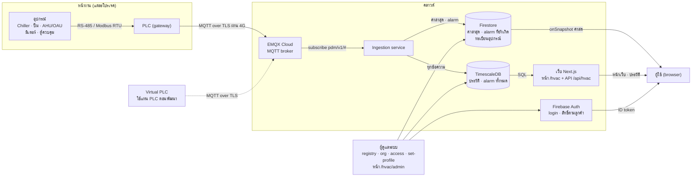

## A2. เส้นทางข้อมูลหลัก 4 เส้น

**หน้าที่:** ข้อมูลแต่ละประเภทเดินทางอย่างไร และใช้เวลาเท่าไร

| เส้นทาง | ลำดับ | ความเร็ว |
|---|---|---|
| 1. ค่าสด | PLC → EMQX → Ingestion → Firestore → browser (onSnapshot) | ตามรอบส่งของ PLC (ปกติ 60 วินาที) แล้วขึ้นจอภายในไม่กี่วินาที |
| 2. ประวัติ | PLC → EMQX → Ingestion → TimescaleDB → API ของเว็บ → browser | โหลดเมื่อเปิดหน้า trend, รายงาน, พลังงาน หรือประวัติ alarm |
| 3. Alarm | fault word ใน telemetry หรือ event → SQL ใน TimescaleDB เปิดหรือปิด alarm → Firestore → browser | ผ่าน event ขึ้นจอภายในประมาณ 5 ถึง 10 วินาทีหลังเกิด fault |
| 4. สิทธิ์ | ผู้ดูแล → ลูกค้าของบัญชี (custom claims ใน Firebase Auth) และลูกค้าเจ้าของโปรเจค (`projects/{project}.org` ใน Firestore) → `firestore.rules` และ API ตรวจสิทธิ์ | เพิ่มหรือถอนโรงงานของลูกค้า: มีผลทันที (API ภายใน 1 นาที) ให้หรือถอนสิทธิ์บัญชี: เมื่อผู้ใช้ login ใหม่ กด "ตรวจอีกครั้ง" หรือ token ต่ออายุ (ไม่เกิน 1 ชั่วโมง) |

```mermaid
flowchart TB
  subgraph p1["1. ค่าสด"]
    direction LR
    a1["PLC"] --> a2["EMQX"] --> a3["Ingestion"] --> a4[("Firestore")] -->|"onSnapshot"| a5["browser"]
  end
  subgraph p2["2. ประวัติ"]
    direction LR
    b1["PLC"] --> b2["EMQX"] --> b3["Ingestion"] --> b4[("TimescaleDB")] -->|"SQL"| b5["API เว็บ"] -->|"HTTPS + ID token"| b6["browser"]
  end
  subgraph p3["3. Alarm"]
    direction LR
    c1["fault word<br/>ใน telemetry / event"] --> c2["SQL apply_fault_words<br/>เปิด / ปิด alarm"] --> c3[("Firestore alarms")] --> c4["browser"]
    c4 -->|"กดรับทราบ"| c5["API /api/hvac/alarms"] --> c6[("TimescaleDB + Firestore<br/>(alarm การสื่อสาร: Firestore commAcks)")]
  end
  subgraph p4["4. สิทธิ์"]
    direction LR
    d1["ผู้ดูแล<br/>npm run access"] --> d2["Firebase Auth<br/>custom claims (orgs)"] --> d3["ID token<br/>ของผู้ใช้"] --> d4["firestore.rules<br/>และ API ตรวจสิทธิ์"]
    d5["ผู้ดูแล<br/>npm run org"] --> d6[("Firestore<br/>projects/{project}.org")] --> d4
  end
```

---

# ส่วน B: รายละเอียดแยกตามส่วน

## B1. PLC หน้างาน

**หน้าที่:** การทำงานของ PLC ตั้งแต่เปิดเครื่อง อ่านค่า ส่งข้อมูล จนถึงตอนเน็ตหลุด

**ขั้นตอน:**

1. เปิดเครื่อง แล้วซิงก์นาฬิกาด้วย NTP (อย่างน้อยวันละครั้ง)
2. เชื่อมต่อ EMQX
   - TLS 1.2 ขึ้นไป และส่ง SNI
   - client id `{project}.{gateway}` พร้อม username/password ของ PLC ตัวนั้น
   - ตั้ง Last Will เป็น status `offline` แบบ retain
3. ส่ง status `online` แบบ retain พร้อมเวอร์ชันโปรแกรม (`fw`)
4. ถ้ามีข้อความค้างใน buffer ให้ส่งจากเก่าไปใหม่ โดยใช้ `ts` เดิม
5. สแกน Modbus ทุกประมาณ 5 วินาที
   - **point ชนิด state, code หรือ bits เปลี่ยน:** ส่ง event ทันที
   - **อ่านค่าไม่ได้:** ไม่นับเป็นการเปลี่ยน
6. ถึงขอบรอบ (เช่น วินาทีที่ 00 ของทุกนาที) ให้สร้างข้อความ telemetry
   - `ts` เท่ากับขอบรอบ และ `seq` เพิ่มทีละ 1
   - `devices` เป็นค่าหน่วยวิศวกรรมที่ scale แล้ว ค่าที่อ่านไม่ได้เป็น `null`
   - `errors` เป็นรายชื่ออุปกรณ์ที่ไม่ตอบ
7. ถ้าข้อความใหญ่เกิน 64 KB ให้แบ่งเป็นหลายข้อความที่ใช้ `ts` เดียวกัน
8. เชื่อมต่ออยู่: publish ด้วย QoS 1 ไม่ได้เชื่อมต่อ: เก็บลง buffer (แนะนำอย่างน้อย 3 วัน)
9. ปิดเครื่องตามปกติ: ส่ง `offline` เอง ไฟดับหรือเน็ตหลุด: broker ส่ง Last Will แทน

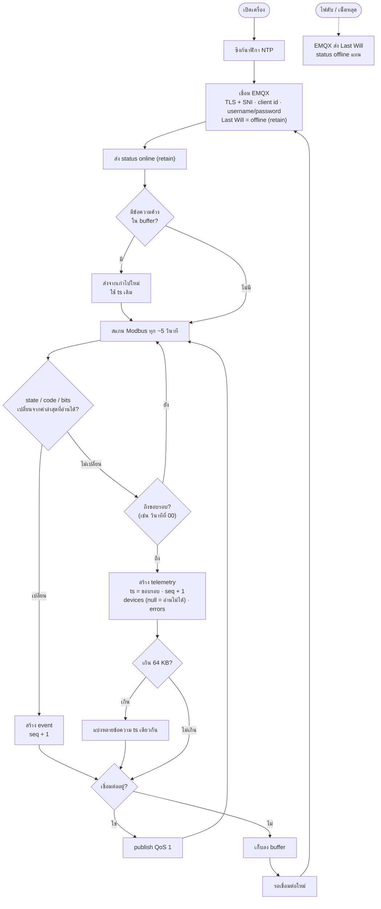

## B2. รูปแบบข้อความ MQTT (contract v1)

**หน้าที่:** topic และข้อความ 3 ชนิดที่ PLC ส่ง (รายละเอียดเต็มใน [`TELEMETRY.md`](TELEMETRY.md))

| ชนิด | Topic | ส่งเมื่อ | Retain | ฟิลด์หลัก |
|---|---|---|---|---|
| telemetry | `pdm/v1/{project}/{gateway}/telemetry` | ทุกรอบ (ปกติ 60 วินาที) | ไม่ | `v`, `ts`, `seq`, `interval`, `devices`, `errors` |
| event | `pdm/v1/{project}/{gateway}/event` | ทันทีที่ state, code หรือ bits เปลี่ยน | ไม่ | `v`, `ts`, `seq`, `changes[{device, point, value}]` |
| status | `pdm/v1/{project}/{gateway}/status` | เมื่อเชื่อมต่อ (`online`) และเป็น Last Will (`offline`) | ใช่ | `v`, `state`, `ts`, `fw` |

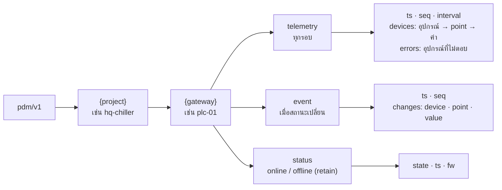

## B3. MQTT broker (EMQX Cloud)

**หน้าที่:** การตรวจสิทธิ์และการส่งต่อข้อความของ broker

**ขั้นตอน:**

1. **ตรวจการเชื่อมต่อ:** ต้องเป็น TLS พร้อม SNI แล้วจึงตรวจ username/password
2. **ตรวจสิทธิ์ตอน publish หรือ subscribe:** กฎ "All Users" ปิดทุก topic (`#`) แล้วเปิดให้รายผู้ใช้
   - `virtual-plc` และ PLC จริง publish ได้อย่างเดียว PLC จริงแต่ละตัวได้เฉพาะ topic ของตัวเอง
   - `ingest` subscribe `pdm/v1/#` ได้อย่างเดียว
3. **ส่งต่อให้ผู้ subscribe:** ด้วย QoS 1
4. **ingestion ปิดอยู่:** broker เก็บข้อความไว้ใน persistent session ตาม client id แล้วส่งให้เมื่อกลับมาเชื่อมต่อ
5. **PLC หลุดโดยไม่บอก:** broker publish Last Will (`offline`) แทน
6. **status ถูกเก็บแบบ retain:** ผู้ subscribe ใหม่จะได้สถานะล่าสุดของทุก PLC ทันที

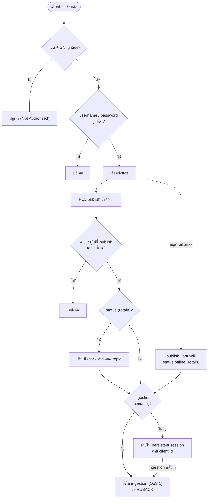

## B4. Ingestion: การเริ่มทำงาน

**หน้าที่:** สิ่งที่ ingestion ทำตอนเปิดโปรแกรม ก่อนเริ่มรับข้อความ

**ขั้นตอน:**

1. อ่านค่าตั้งจาก `.env` (บน Cloud Run ใช้ตัวแปรของ service)
2. เปิด connection pool ไปยัง TimescaleDB ด้วย CA ที่ฝังไว้ (`certs/tiger-ca.pem`)
3. **Migrate:** ล็อกด้วย advisory lock กันการรันซ้อน แล้วทำตามลำดับ
   1. สร้างหรืออัปเดตตาราง
   2. สร้าง SQL function ใหม่ใน transaction เดียว
   3. ลงชื่อ fault bit จาก profile ในโค้ด
   4. ตั้งนโยบายบีบอัดข้อมูล, ลบข้อมูลเก่า และสรุปรายชั่วโมง
4. ถ้าตั้ง `FIREBASE_PROJECT_ID` จะเปิด live view ใน Firestore
   - ซิงก์ alarm ที่ยังเกิดอยู่จาก TimescaleDB ไป Firestore ทันที แล้วทำซ้ำทุก 10 นาที
5. เชื่อม MQTT ด้วย client id คงที่และ `clean: false` เพื่อรับข้อความที่ค้างระหว่างปิด
6. subscribe `pdm/v1/#` ด้วย QoS 1 ถ้า broker ปฏิเสธ โปรแกรมจะหยุดพร้อมบอกให้เพิ่มสิทธิ์
7. เปิด health check ที่ `/healthz` (พอร์ต 8090)

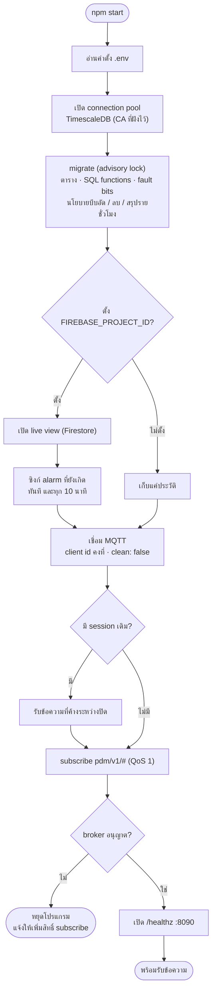

## B5. Ingestion: การจัดการแต่ละข้อความ

**หน้าที่:** ทุกข้อความที่เข้ามาผ่านขั้นตอนนี้ หลักสำคัญคือตอบรับ (PUBACK) ให้ broker **หลังบันทึกลงฐานข้อมูลสำเร็จเท่านั้น** ข้อมูลจึงไม่หายแม้โปรแกรมหรือฐานข้อมูลล่ม

**ขั้นตอน:**

1. **ตรวจ topic:** ถ้าไม่ตรงรูปแบบ `pdm/v1/{project}/{gateway}/{channel}` ให้ปฏิเสธ และตอบรับเพื่อทิ้งข้อความ
2. **ข้อความว่าง:** เป็นการล้าง retain ให้ข้ามไป
3. **ตรวจเนื้อหาตามสเปก:** ถ้าไม่ผ่าน เช่น `ts` ล่วงหน้าเกิน 5 นาที ย้อนหลังเกิน 30 วัน หรือรหัสผิดรูปแบบ ให้ปฏิเสธและตอบรับ
4. **ตรวจ `seq`:** ถ้ากระโดดให้บันทึกคำเตือนว่าข้อความหายหรือ PLC รีสตาร์ต แต่ยังบันทึกต่อ
5. **บันทึกลง TimescaleDB:** เรียก SQL function เดียวต่อข้อความ (`ingest_telemetry`, `ingest_event` หรือ `ingest_status`)
   - **สำเร็จ:** เขียน Firestore แบบ best effort (ล้มก็ไม่เป็นไร เพราะ TimescaleDB คือข้อมูลหลัก) แล้วตอบรับ
   - **ฐานข้อมูลปฏิเสธข้อความนี้เอง:** ทิ้งและตอบรับ เพราะส่งซ้ำก็ไม่สำเร็จ
   - **ฐานข้อมูลไม่ตอบชั่วคราว:** ลองใหม่หลัง 1, 2 และ 4 วินาที ถ้ายังไม่ได้จะไม่ตอบรับ แล้ว broker จะส่งซ้ำ
6. **ข้อความซ้ำจาก QoS 1:** ไม่เพิ่มแถวในฐานข้อมูล เพราะมี unique key

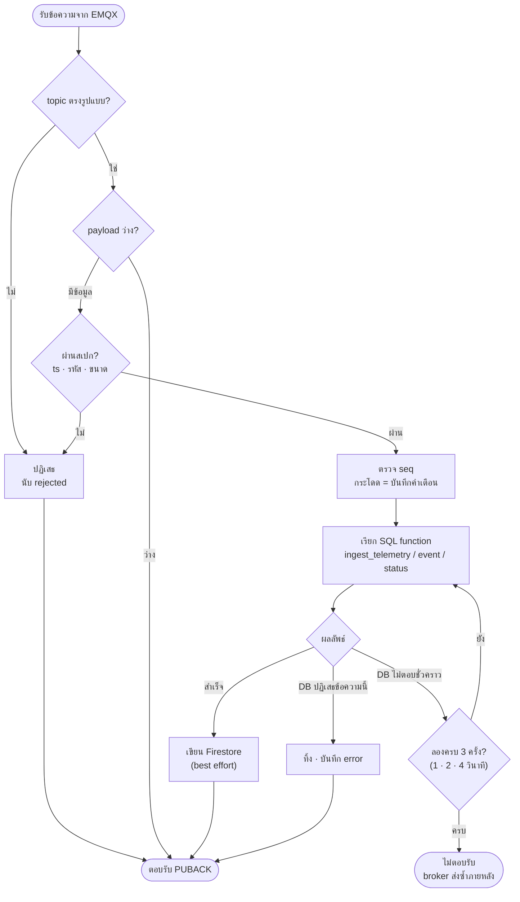

## B6. ฐานข้อมูลประวัติ (TimescaleDB)

**หน้าที่:** SQL function แต่ละตัวทำอะไร และข้อมูลถูกเก็บอย่างไรตลอดอายุ

**ตาราง:**

| ตาราง | เก็บอะไร |
|---|---|
| `telemetry` | ทุกค่าของทุกรอบ (hypertable) หนึ่งแถวต่อ ค่า × อุปกรณ์ × เวลา |
| `telemetry_1h` | สรุปรายชั่วโมง (avg, min, max, last, จำนวน) อัปเดตอัตโนมัติทุก 30 นาที |
| `events` | การเปลี่ยนสถานะ รวมถึง `_comm` (อุปกรณ์เริ่มหรือหยุดตอบ) และ `_online` (PLC ออนไลน์หรือออฟไลน์) |
| `devices` | อุปกรณ์ที่เคยส่งข้อมูลหรือตั้งทะเบียนแล้ว, รุ่น (profile), ค่า Modbus ของเครื่อง (`modbus`: gateway, พอร์ต, slave ID, โมดูล, register ที่ต่างจากรุ่น), สถานะการสื่อสารล่าสุด |
| `gateways` | PLC แต่ละตัว: สถานะ, รอบส่ง, ts และ seq ล่าสุด |
| `alarms` | alarm ทุกครั้ง: เวลาเริ่ม, เวลาจบ, การรับทราบ |
| `profiles` | รุ่นอุปกรณ์: register map ของรุ่น (`spec`: รูปแบบ address, ค่าสื่อสาร, โมดูล, ตาราง register) แก้ที่ `/hvac/admin` แท็บรุ่นอุปกรณ์ |
| `fault_bits` | ชื่อ fault แต่ละ bit ของแต่ละรุ่น (ไทยและอังกฤษ) แก้พร้อมรุ่นบนหน้าเว็บ |
| `fault_words` | ค่า fault word ล่าสุดของแต่ละอุปกรณ์ ใช้กันข้อความเก่าปิด alarm ผิด |

**ขั้นตอนของ `ingest_telemetry`:**

1. **ตรวจว่าเป็นรอบล่าสุดหรือไม่:** เทียบ `ts` กับ ts ล่าสุดของ PLC ตัวนั้น ถ้าเก่ากว่า แปลว่าเป็นข้อมูลจาก buffer
2. **เพิ่มแถวลง `telemetry`:** แถวที่มีอยู่แล้วไม่เพิ่มซ้ำ
3. **บันทึกการสื่อสาร:** อุปกรณ์ที่เพิ่งหยุดตอบหรือกลับมาตอบ บันทึกเป็น event `_comm`
4. **อัปเดต `devices` และ `gateways`:** เวลาที่เห็นล่าสุด, สถานะการสื่อสาร, seq
5. **แปลง fault word เป็น alarm:** เรียก `apply_fault_words` (ดู B7)
6. **ส่งผลกลับ:** จำนวนแถวที่เพิ่ม, เป็นรอบล่าสุดหรือไม่, และ alarm ที่เปิดหรือปิด

**`ingest_event` และ `ingest_status`:**

- **`ingest_event`:** บันทึกลง `events` อัปเดต `gateways` แล้วเรียก `apply_fault_words` เหมือนกัน alarm จึงขึ้นได้ภายในไม่กี่วินาที
- **`ingest_status`:** อัปเดตสถานะของ PLC ใน `gateways` ถ้าสถานะเปลี่ยนจะบันทึก event `_online`

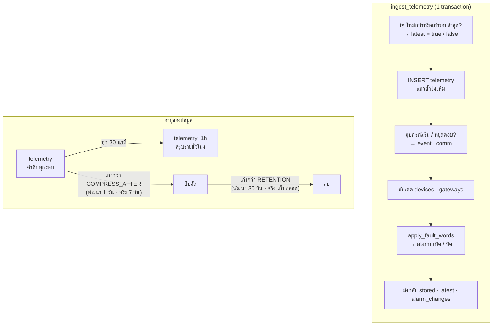

## B7. Fault word → alarm

**หน้าที่:** การแปลงค่า fault word (ตัวเลข 16 bit จาก register) เป็น alarm ที่มีชื่อ ทำใน SQL (`apply_fault_words`) ภายใน transaction เดียวกับการบันทึก

**ขั้นตอน:**

1. รับ point ที่เป็น fault word เช่น `fault1` ถึง `fault4` ของ Carrier 30RAM จาก telemetry หรือ event
2. **ข้ามค่านี้ถ้าเข้าเงื่อนไขใดเงื่อนไขหนึ่ง:**
   - อุปกรณ์ยังไม่ได้กำหนดรุ่น (`profile`)
   - word นี้ไม่มีในรุ่นนั้น
   - ค่าเป็น `null`
   - ค่าเก่ากว่าค่าที่เคยรับ เช่น ข้อมูลจาก buffer หรือข้อความที่ส่งซ้ำ
3. **ปิด alarm:** alarm ที่เปิดอยู่ของ word นี้ ถ้า bit ของมันกลายเป็น 0 ให้ใส่เวลาจบ
4. **เปิด alarm:** ทุก bit ที่เป็น 1 (bit 0 ถึง 15) ที่ยังไม่มี alarm เปิดอยู่
   - ชื่อมาจาก `fault_bits` ของรุ่นนั้น
   - bit ที่ไม่มีในเอกสารใช้ชื่อ `<word>_bit<n>` ระดับ warning
5. บันทึกค่า word ล่าสุดลง `fault_words`
6. ส่งรายการ alarm ที่เปิดหรือปิดกลับไปให้ ingestion เขียน Firestore (ดู B8)

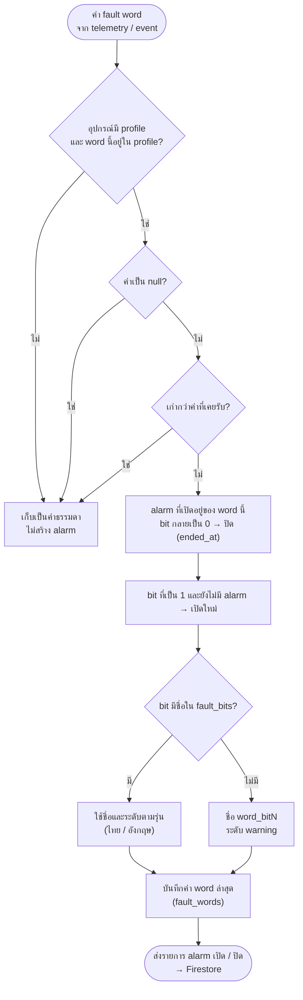

## B8. Firestore (ค่าล่าสุดสำหรับหน้าจอ)

**หน้าที่:** ingestion เขียนอะไรลง Firestore และเมื่อไร หน้าจอฟังเอกสารเหล่านี้แบบ realtime

**โครงสร้างเอกสาร:**

| เอกสาร | ใครเขียน | เนื้อหา |
|---|---|---|
| `projects/{project}` | ผู้ดูแล (`npm run registry`, `npm run org` หรือหน้า `/hvac/admin`) | `name` (ชื่อโรงงานที่ลูกค้าเห็นในตัวเลือกโปรเจค), `ownerLogo` (โลโก้เจ้าของ ไม่บังคับ), `updatedAt`, ทะเบียนอุปกรณ์: `devices.{id}` = kind, name, order, label, meterFor, capacityTon, role และ `org` (ลูกค้าเจ้าของโปรเจค ตั้งด้วย `npm run org` หรือหน้า admin: แท็บลูกค้า หรือช่องลูกค้าเจ้าของในหน้าต่างแก้ไขโรงงาน ทั้งสองทางผ่าน `assignProjects` ส่วนการตั้งทะเบียนอุปกรณ์ (`saveRegistry`) ไม่แตะ field นี้) |
| `orgs/{org}` | ผู้ดูแล (`npm run org` หรือหน้า `/hvac/admin`) | ลูกค้า: `name` (ชื่อที่แสดงเป็นหัวกลุ่มในตัวเลือกโปรเจค), createdAt, updatedAt |
| `adminLog/{id}` | API `/api/hvac/admin` และคำสั่ง `org` / `access` / `registry` | บันทึกการเปลี่ยนแปลงลูกค้า โรงงาน และบัญชี: at, actor (อีเมล หรือ ผู้ใช้@เครื่อง), via (web / cli), action, target, details browser อ่านไม่ได้ |
| `projects/{project}/gateways/{gateway}` | ingestion | state, stateAt, fw, interval, lastTs, seq, lastSeen และ `devices.{id}` = values, ok, error, ts, changedAt |
| `projects/{project}/alarms/{id}` | ingestion และ API รับทราบ | เฉพาะ alarm ที่ยังเกิดอยู่: device, code, severity, ชื่อไทยและอังกฤษ, startedAt, ackedAt, ackedBy |
| `notifyConfig/{project}` | API ผู้ดูแล (หน้า `/hvac/admin` ปุ่ม "การแจ้งเตือน") | ค่าตั้งอีเมลแจ้งเตือนของโรงงาน: enabled, recipients, minSeverity, cleared, locale, updatedAt, updatedBy browser อ่านไม่ได้ (อีเมลผู้รับเป็นข้อมูลส่วนบุคคล) |
| `notifyState/{project}` | ingestion (ตัวส่งอีเมล) | alarm ที่ส่งอีเมลไปแล้วและยังไม่หาย (`open.{alarm id}`) ใช้กันส่งซ้ำ browser อ่านไม่ได้ |
| `mail/{id}` | ingestion, API ผู้ดูแล (อีเมลทดสอบ) และฟอร์มขอเดโม | คิวอีเมลให้ extension "Trigger Email from Firestore" ส่ง: to, message (subject, text, html), source, deleteAfter browser อ่านไม่ได้ |
| `projects/{project}/commAcks/{key}` | API รับทราบ | การรับทราบ alarm การสื่อสารครั้งล่าสุดของแต่ละ gateway หรืออุปกรณ์ (`key` = `gateway:<id>` หรือ `comm:<id>`): since (การขาดการติดต่อรอบที่รับทราบ), ackedAt, ackedBy และ history (การรับทราบ 50 ครั้งล่าสุด ใช้ในประวัติ alarm) |

**ขั้นตอน (ทุกข้อความเขียนเป็น batch เดียว):**

1. **telemetry:** ถ้าเป็นรอบล่าสุด อัปเดตเอกสาร gateway ด้วยค่าล่าสุดของทุกอุปกรณ์
   - ค่า `null` ไม่เขียนทับ หน้าจอจึงคงค่าล่าสุดที่อ่านได้
   - ถ้าเป็นข้อมูลเก่าจาก buffer ไม่เขียน เก็บเป็นประวัติอย่างเดียว
2. **event:** อัปเดตเฉพาะ point ที่เปลี่ยน พร้อมเวลา `changedAt`
3. **status:** อัปเดต state, stateAt และ fw
4. **alarm ที่เปิด:** สร้างเอกสารใน `alarms` **alarm ที่ปิด:** ลบเอกสาร
5. **ทุก 10 นาทีและตอนเริ่มโปรแกรม:** เทียบ alarm ที่ยังเกิดใน TimescaleDB กับ Firestore แล้วซ่อมให้ตรงกัน
6. **สิทธิ์ของผู้ใช้ (`firestore.rules`):** อ่านได้เฉพาะโปรเจคที่มีสิทธิ์ (ดู B9) และเขียนจาก browser ไม่ได้
   - `projects/{project}`: อ่านได้เมื่อ `org` ของเอกสารอยู่ใน claim `orgs` ของบัญชี, รหัสโปรเจคอยู่ใน claim `projects` หรือบัญชีเป็น `admin`
   - ข้อมูลใต้โปรเจค (`gateways`, `alarms`): ตรวจแบบเดียวกัน โดย rules อ่านเอกสารโปรเจคเพิ่ม 1 ครั้ง (`get()`) ทุกครั้งที่ประเมิน ราว 2 read ต่อการเปิดโรงงาน 1 ครั้ง
   - รายชื่อโปรเจค: ลูกค้า query `where("org", "in", <orgs>)` ผู้ดูแลอ่านได้ทั้ง collection
   - `orgs/{org}`: อ่านได้เฉพาะลูกค้าของตัวเอง ผู้ดูแลอ่านได้ทั้งหมด
   - ทดสอบ rules กับ emulator ด้วย `npm run test:rules` ใน `pdm-app` (ดู `DEPLOY.md`)

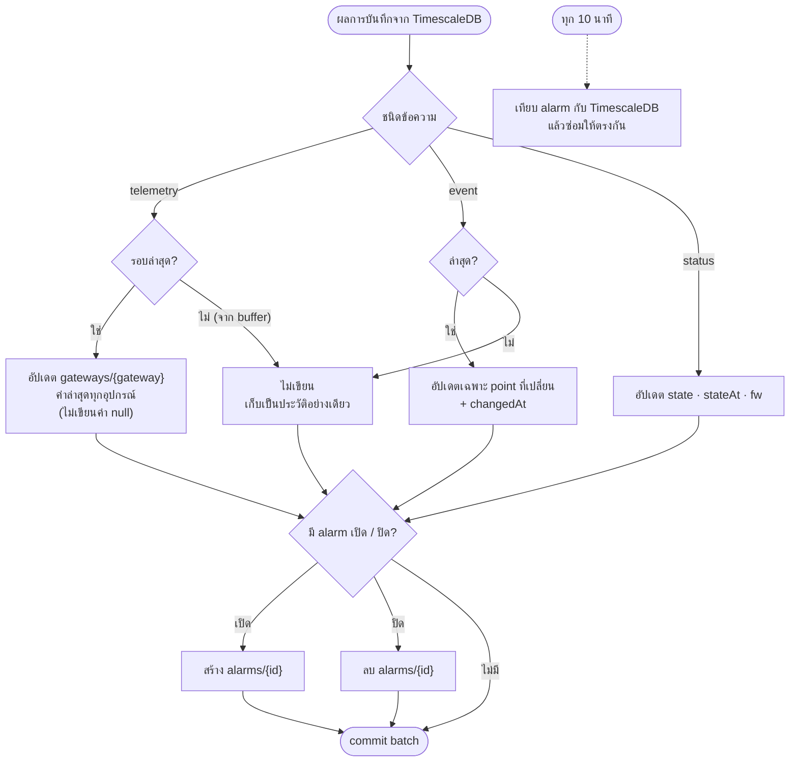

## B9. เว็บ: เข้าสู่ระบบและสิทธิ์

**หน้าที่:** ตั้งแต่เปิดหน้า `/hvac` จนเห็นข้อมูลของโปรเจค

**ขั้นตอน:**

1. **ตรวจโหมดของเว็บ (`NEXT_PUBLIC_HVAC_SOURCE`):**
   - `sim`: แสดงข้อมูลจำลองทันที ไม่ต้อง login
   - `live`: ทำขั้นถัดไป
2. **ยังไม่ login:** แสดงฟอร์มอีเมลและรหัสผ่าน
   - มีลิงก์ "ลืมรหัสผ่าน" ซึ่งส่งอีเมลให้ตั้งรหัสใหม่
   - ไม่มีหน้าสมัครเอง บัญชีสร้างโดยผู้ดูแล
3. **login สำเร็จ:** Firebase ออก ID token ที่มี custom claims (ตั้งด้วย `npm run access`)
   - `orgs`: ลูกค้าที่บัญชีสังกัด เห็นทุกโปรเจคที่ `org` ตรงกัน รวมถึงโปรเจคที่เพิ่มให้ลูกค้าภายหลัง (วิธีหลัก)
   - `projects`: โปรเจคที่ให้เป็นรายตัว ใช้กับกรณียกเว้น เช่น ผู้รับเหมาที่ดูแลโรงงานเดียว
   - `admin`: ทีมดูแลระบบ เห็นทุกโปรเจค
4. **หารายชื่อโปรเจคที่เปิดได้ (realtime):**
   - ลูกค้า: query `projects` ที่ `org` อยู่ใน `orgs` ของบัญชี
   - ผู้ดูแล: ทุกเอกสารใน `projects`
   - บวกโปรเจคใน `projects` ของบัญชี
   - เมื่อผู้ดูแลเพิ่มหรือถอนโรงงานของลูกค้า รายชื่อเปลี่ยนทันทีโดยไม่ต้อง login ใหม่ ถ้าโรงงานที่เปิดอยู่ถูกถอน หน้าจอย้ายไปโรงงานแรกที่เหลือ
   - ระหว่างรอคำตอบแรกจาก server แสดง "กำลังตรวจสอบ" (ถ้าไม่มีเน็ต รอจนต่อได้ ไม่ขึ้นหน้าไม่มีสิทธิ์)
5. **ไม่มีโปรเจคให้เปิด:** แสดงหน้า "บัญชีนี้ยังไม่ได้รับสิทธิ์ดูโรงงานใด" (บัญชีผู้ดูแลขึ้น "ยังไม่มีโปรเจคในระบบ")
   - ปุ่ม "ตรวจอีกครั้ง" ขอ token ใหม่เพื่อรับสิทธิ์ล่าสุด
6. **มีโปรเจค:** เลือกโปรเจค
   - ใช้โปรเจคที่เปิดครั้งก่อน (เก็บใน browser) ถ้ายังเปิดได้ ไม่อย่างนั้นใช้โปรเจคแรก แล้วจำไว้ โรงงานที่เพิ่มเข้ามาภายหลังจึงไม่แย่งที่โรงงานที่เปิดอยู่
7. **เข้าหน้าหลัก:** สลับโปรเจคหรือออกจากระบบได้ที่เมนูบัญชีมุมขวาบน
   - เมนูเรียงตามชื่อลูกค้า (`orgs/{org}.name`) แล้วตามชื่อโรงงาน
   - แสดงหัวกลุ่มเป็นชื่อลูกค้าเมื่อเป็นผู้ดูแล หรือเมื่อบัญชีเห็นมากกว่า 1 กลุ่ม
   - โปรเจคที่ได้เป็นรายตัวอยู่ในกลุ่ม "โปรเจคอื่น ๆ" ส่วนผู้ดูแลจะเห็นโปรเจคที่ยังไม่ผูกลูกค้าในกลุ่ม "ยังไม่ระบุลูกค้า"
   - ผู้ดูแลระบบเห็นเมนู "ลูกค้า โรงงาน และบัญชี" (`/hvac/admin`) เพิ่มในแถบเมนู ดู B13
8. **ทุกครั้งที่อ่านข้อมูล:** `firestore.rules` และ API ตรวจสิทธิ์ซ้ำจาก token และ `org` ของโปรเจค

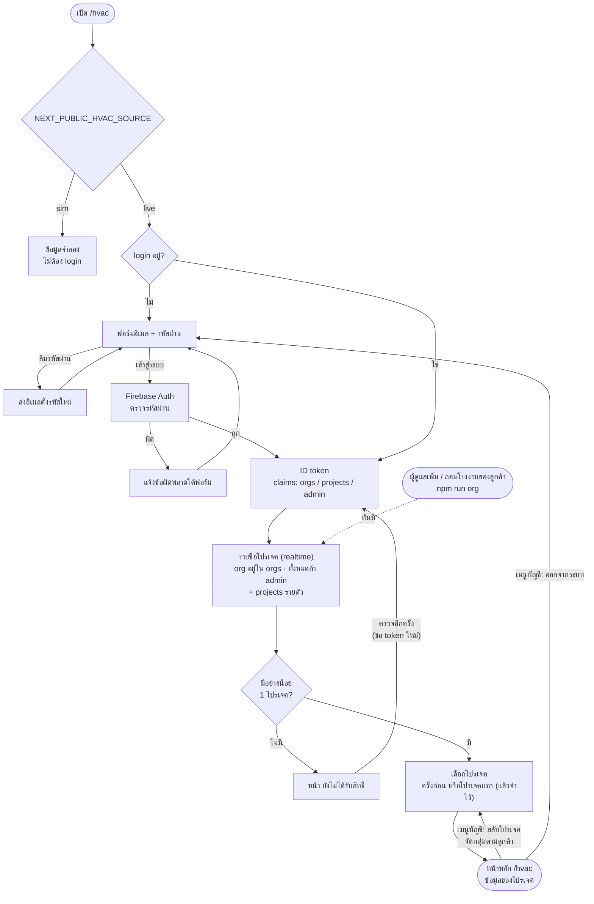

## B10. เว็บ: ค่าสด

**หน้าที่:** หน้าภาพรวม, พลังงาน, หน้าต่างรายละเอียดอุปกรณ์ และรายการ alarm ได้ค่าล่าสุดอย่างไร

**ขั้นตอน:**

1. **เปิดการฟังแบบ realtime (onSnapshot) 4 จุดของโปรเจค:**
   - `projects/{project}`: ทะเบียนอุปกรณ์ ใช้วาดผังโรงงาน
   - `gateways`: ค่าล่าสุดของอุปกรณ์
   - `alarms`: alarm จาก fault word ที่ยังเกิดอยู่
   - `commAcks`: การรับทราบ alarm การสื่อสาร (ถ้าอ่านไม่ได้ หน้าจอยังแสดงผลได้ แต่ alarm การสื่อสารจะขึ้นเป็นยังไม่รับทราบ)
2. **คำนวณใหม่เมื่อข้อมูลเปลี่ยน และทุก 15 วินาที:**
   1. **PLC เงียบ** (สถานะ offline หรือไม่มีข้อมูลเกิน 2.5 เท่าของรอบส่ง): alarm การสื่อสารระดับ critical และอุปกรณ์ของ PLC นั้นขึ้น OFFLINE
   2. **อุปกรณ์ไม่ตอบ:** alarm การสื่อสารระดับ warning
   3. **ค่าที่ PLC ไม่ได้ส่ง คำนวณเพิ่มในเว็บ:**
      - ตันความเย็น = flow × 1.163 × ΔT ÷ 3.517 (chiller ที่ไม่ส่ง flow คำนวณไม่ได้ จึงเป็น "—")
      - kW ของ chiller: จากมิเตอร์ที่ตั้ง `meterFor` เป็นเครื่องนั้น ถ้าไม่มีหรือมิเตอร์ offline ใช้ค่าที่เครื่องส่งเอง
      - โหลด %: ถ้าเครื่องไม่ส่ง ใช้สัดส่วนคอมเพรสเซอร์ที่เดิน (รุ่น modular เช่น Carrier 30RAM)
      - kW/Ton
      - อุณหภูมิ header
      - กำลังไฟรวมจากมิเตอร์
   4. **อุปกรณ์ที่ส่งข้อมูลแต่ไม่อยู่ในทะเบียน:** แยกไว้ในหมวด "อุปกรณ์ที่ยังไม่อยู่ในรายชื่อ"
3. **แสดงผล:** ค่าที่ไม่รู้แสดงเป็น "—" ส่วนหน้ารายละเอียด chiller และรายการค่าให้เลือกใน Trend และรายงาน แสดงเฉพาะค่าที่อุปกรณ์ส่งมาจริง (ค่าที่อุปกรณ์ไม่เคยส่งถูกซ่อน)
4. **ไม่มีข้อมูลใหม่เกิน 2.5 รอบ:** ขึ้นแถบเตือนว่าค่าบนจอเก่า
5. **Firestore ปฏิเสธ** (เช่น ถูกถอนสิทธิ์): ขึ้นแถบแจ้งว่าเปิดโปรเจคนี้ไม่ได้แล้ว

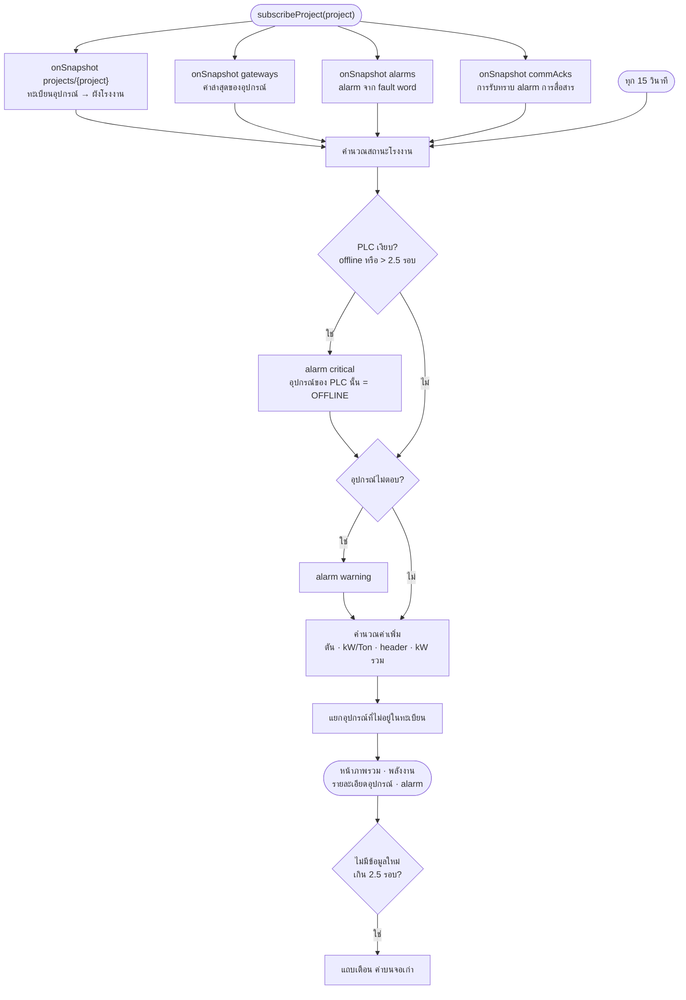

## B11. เว็บ: ประวัติ trend รายงาน และพลังงาน

**หน้าที่:** หน้าที่ต้องใช้ข้อมูลย้อนหลังดึงจาก TimescaleDB ผ่าน API ของเว็บ เพราะ browser ต่อฐานข้อมูลตรงไม่ได้

**ขั้นตอน:**

1. หน้าจอส่งคำขอพร้อม ID token
   - **trend และรายงาน:** `GET /api/hvac/history` ระบุ project, points (ไม่เกิน 24), ช่วงเวลา และ step
   - **พลังงาน:** `GET /api/hvac/energy` ระบุมิเตอร์และเวลาที่ต้องการค่า kWh
   - **ประวัติ alarm:** `GET /api/hvac/alarms` ระบุช่วงเวลา
2. **API ตรวจ token และสิทธิ์โปรเจค (`lib/server/hvac-auth.ts`, กฎเดียวกับ `firestore.rules`):** ไม่มี token, หมดอายุ, ถูกยกเลิก หรือบัญชีถูกปิดใช้ ได้ 401 ไม่มีสิทธิ์โปรเจคได้ 403
   - การตรวจการยกเลิกอ่านบัญชีใน Firebase Auth 1 ครั้งต่อคำขอ บัญชีที่ถูกปิดใช้จึงใช้ API ไม่ได้ทันที (ถ้า server อ่าน Auth ไม่ได้ ตอบ 503)
   - ผ่านทันทีถ้าเป็น `admin` หรือมีรหัสโปรเจคใน `projects`
   - ไม่อย่างนั้นดู `org` ของเอกสารโปรเจคว่าอยู่ใน `orgs` ของบัญชีไหม (อ่านจาก cache เดียวกับทะเบียนอุปกรณ์ ย้ายโรงงานไปลูกค้าอื่นจึงมีผลกับ API ภายใน 60 วินาที)
3. **API อ่านทะเบียนอุปกรณ์:** จาก Firestore โดยเก็บไว้ในหน่วยความจำ 60 วินาที แล้วตรวจว่า point ที่ขอมีอยู่จริง
4. **คำนวณ point ดิบที่ต้องใช้:** เช่น ตันรวมของโรงงานต้องใช้ flow และอุณหภูมิของทุก chiller
5. **query แบบ `time_bucket`:**
   - ค่าแบบ analog ใช้ค่าเฉลี่ย
   - สถานะ รหัส และตัวนับ ใช้ค่าสุดท้าย
6. แต่ละช่วงเวลาผ่านฟังก์ชันเดียวกับค่าสด (`snapFromReadings`) ตัวเลขในกราฟจึงตรงกับหน้าภาพรวม
7. **พลังงาน:** ใช้ผลต่างของมิเตอร์ kWh ระหว่างสองเวลา แต่ละเวลาใช้ค่าล่าสุดก่อนหน้าภายใน 1 ชั่วโมง ถ้าไม่มีแสดง "—"
8. **ประวัติ alarm:** รวม 3 แหล่ง
   - alarm จาก fault word
   - ช่วงที่อุปกรณ์ไม่ตอบ (`_comm`)
   - ช่วงที่ PLC ออฟไลน์ (`_online`)

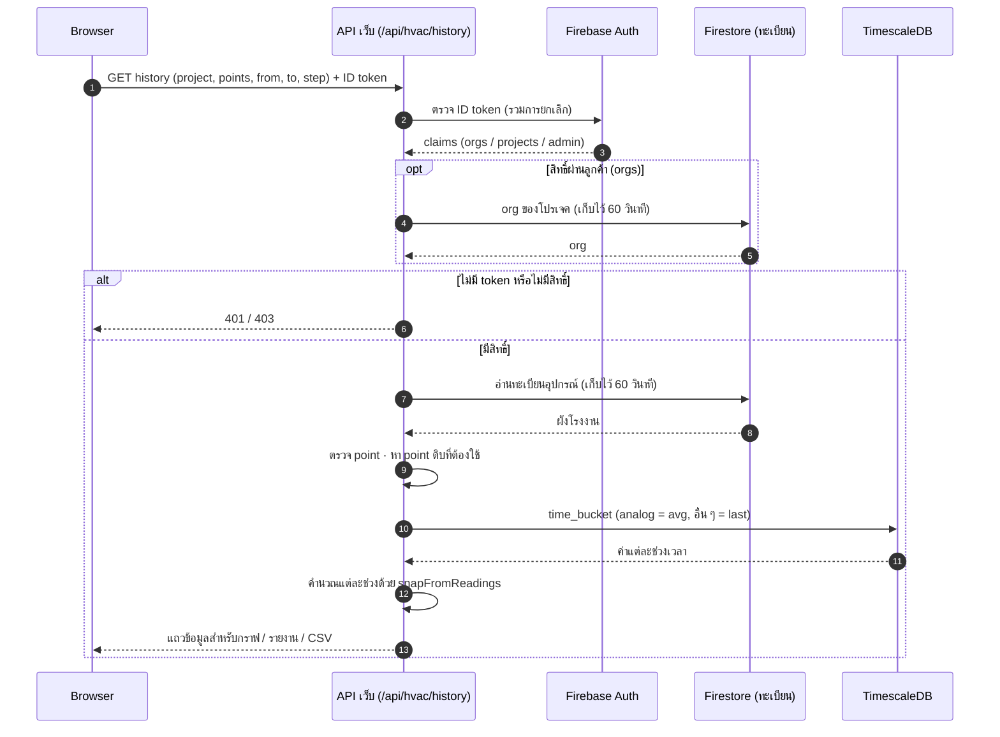

## B12. รับทราบ alarm

**หน้าที่:** เมื่อผู้ใช้กดรับทราบ alarm สถานะถูกเก็บถาวรและผู้ใช้ทุกคนเห็นตรงกัน

**ขั้นตอน:**

1. ผู้ใช้เลือก alarm แล้วกด "รับทราบ" หน้าจอเปลี่ยนเป็นรับทราบทันที
2. ส่ง `POST /api/hvac/alarms` พร้อม ID token แล้ว API ตรวจสิทธิ์
3. **alarm จาก fault word:** API บันทึก `acked_at` และ `acked_by` (อีเมลผู้กด) ใน TimescaleDB แล้วอัปเดตเอกสาร alarm ใน Firestore
4. **alarm การสื่อสาร** (เว็บคำนวณจากเอกสาร gateway): API บันทึกลง `commAcks/{key}` ใน Firestore อย่างเดียว จึงใช้ได้แม้ยังไม่ได้ตั้ง TimescaleDB
   - รหัส alarm มีเวลาที่เริ่มขาดการติดต่อติดมาด้วย (`gateway:<id>@<since>`, `comm:<id>@<since>`) การรับทราบจึงมีผลกับรอบนั้นรอบเดียว ขาดการติดต่อรอบใหม่ขึ้นเป็นยังไม่รับทราบ
   - `since` คือเวลาที่ได้ข้อความล่าสุดจาก gateway (เวลา server) หรือรอบล่าสุดที่อุปกรณ์ตอบ (0 ถ้าไม่เคยตอบ) ค่าไม่เปลี่ยนตลอดรอบที่ขาดการติดต่อ
   - API รับเฉพาะ gateway และอุปกรณ์ที่มีอยู่ในเอกสาร gateway ของโปรเจค และเก็บคนที่รับทราบคนแรกของรอบนั้นไว้
   - เก็บประวัติการรับทราบ 50 ครั้งล่าสุดของแต่ละ gateway หรืออุปกรณ์ไว้ใน `history` ของเอกสารเดียวกัน
5. **แสดงผู้รับทราบ:** หน้า Alarm Active, Alarm Logs (รวมไฟล์ CSV) และหน้ารายละเอียดอุปกรณ์ แสดงว่าใครรับทราบและเมื่อไร
   - ประวัติ alarm การสื่อสารใช้เวลาเริ่มจาก event ใน TimescaleDB ซึ่งช้ากว่า `since` ของหน้าจอเล็กน้อย API จึงจับคู่โดยให้แต่ละรอบใช้การรับทราบของ key เดียวกันที่ `since` อยู่ระหว่างตอนจบของรอบก่อนกับตอนเริ่มของรอบนั้น และรับทราบระหว่างที่รอบนั้นยังเกิดอยู่ (คลาดได้ 15 นาที เพราะหน้าจอเห็น gateway เงียบก่อน event offline และนาฬิกา PLC กับ server ต่างกันเล็กน้อย)
   - การรับทราบที่ `since` เก่ากว่าช่วงที่ค้น event (7 วันก่อนช่วงที่เลือก) จะไม่ถูกจับคู่ เพื่อไม่ให้ไปติดกับรอบที่ใหม่กว่า
   - โหมดจำลองไม่มีการ login จึงแสดงเฉพาะเวลา
6. หน้าจอของผู้ใช้ทุกคนที่เปิดโปรเจคนี้เห็นสถานะรับทราบผ่าน onSnapshot

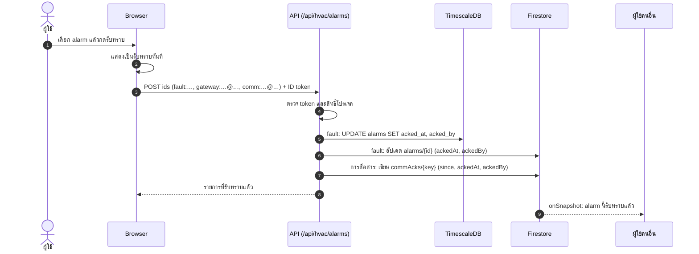

## B13. งานผู้ดูแลระบบ

**หน้าที่:** ขั้นตอนเพิ่มลูกค้า เพิ่มโปรเจค เพิ่มผู้ใช้ และกำหนดรุ่นอุปกรณ์ งานลูกค้า โรงงาน (ทะเบียนอุปกรณ์) และบัญชีทำได้ 2 ทาง ซึ่งใช้โค้ดตรวจและบันทึกชุดเดียวกัน (`pdm-app/src/lib/access/`)
- **หน้าเว็บ `/hvac/admin`** (เมนู "ลูกค้า โรงงาน และบัญชี" เห็นเฉพาะบัญชีที่มี `admin`)
- **คำสั่งในโฟลเดอร์ `services/ingest`** ด้วยสิทธิ์ gcloud ของผู้ดูแล (`npm run org`, `npm run access`, `npm run registry`)

register map ของรุ่นและของแต่ละอุปกรณ์จัดการบนหน้าเว็บเท่านั้น (แท็บรุ่นอุปกรณ์ และปุ่ม Modbus ของโรงงาน) เก็บใน TimescaleDB

ข้อยกเว้น:
- **โรงงานแรกของ Firebase project ใหม่:** ใช้ `npm run registry` เพราะผู้ดูแลที่ยังไม่มีโรงงานใดเลยจะเจอหน้า "ยังไม่มีโปรเจคในระบบ" ก่อนถึง `/hvac/admin`
- **เปลี่ยนรุ่นของอุปกรณ์ทีละกลุ่มด้วย wildcard:** ยังใช้คำสั่ง `npm run set-profile` (บนหน้าเว็บเปลี่ยนรุ่นได้ทีละอุปกรณ์ในตาราง)

**หน้า `/hvac/admin` ทำงานอย่างไร:**

1. หน้าเว็บโหลดภาพรวมจาก `GET /api/hvac/admin`: ลูกค้า, โรงงานที่ตั้งทะเบียนแล้ว (พร้อมจำนวนอุปกรณ์), รหัสโปรเจคที่ส่งข้อมูลมาแต่ยังไม่มีโรงงาน, บัญชีทั้งหมด และบันทึกการเปลี่ยนแปลง 50 รายการล่าสุด
   - ตอนเปิดแก้อุปกรณ์ของโรงงาน โหลดเพิ่มจาก `GET /api/hvac/admin?registry=<project>`: ทะเบียนใน Firestore, รุ่นของแต่ละอุปกรณ์และอุปกรณ์ที่ส่งข้อมูลมาแต่ยังไม่อยู่ในรายการจาก TimescaleDB และเวลาบันทึกล่าสุด (ใช้กันบันทึกทับกัน)
   - ตอนกด **ตั้งทะเบียน** โปรเจคที่ส่งข้อมูลมาแต่ยังไม่มีโรงงาน โหลดจาก `GET /api/hvac/admin?registry=<project>&new=1`: รายการว่างพร้อมอุปกรณ์ที่ส่งข้อมูลมาแล้ว (ถ้ามีผู้ดูแลคนอื่นตั้งทะเบียนไปก่อน จะตอบว่ามีโรงงานนี้แล้ว)
2. ทุกการเปลี่ยนแปลงส่ง `POST /api/hvac/admin` พร้อม ID token แล้ว server ตรวจ 3 ชั้น
   1. token ถูกต้องและไม่ถูกยกเลิก (`verifyIdToken` แบบตรวจการยกเลิก)
   2. บัญชีปัจจุบันยังเปิดใช้อยู่และยังมี `admin` (อ่านจาก Firebase Auth ไม่ใช่จาก token ผู้ดูแลที่ถูกถอนสิทธิ์จึงใช้ token เก่าไม่ได้)
   3. คำขอผ่านการตรวจของ `lib/access/admin.ts`: รหัส, ลูกค้าต้องมีอยู่, โรงงานต้องตั้งทะเบียนแล้ว, claims ไม่เกิน 1000 byte, ถอนสิทธิ์ผู้ดูแลหรือปิดใช้บัญชีของตัวเองไม่ได้ และรายการอุปกรณ์ตาม `lib/access/registry.ts` (ชุดเดียวกับ `npm run registry`)
3. server เขียน Firestore หรือ Firebase Auth ด้วย Admin SDK แล้วบันทึกลง `adminLog` (ใคร ทำอะไร เมื่อไร ทั้งจากหน้าเว็บและจากคำสั่ง)
   - รุ่นอุปกรณ์ (`profiles` + `fault_bits`) และค่า Modbus ของอุปกรณ์ (`devices.modbus`) เขียน TimescaleDB อย่างเดียวใน transaction เดียว แล้วจึงบันทึก `adminLog` ถ้ามีคนบันทึกไปก่อน (เทียบเวลาบันทึกล่าสุด) ตอบ 409
   - การบันทึกอุปกรณ์เขียนรุ่นลง TimescaleDB (`devices.profile`) ก่อน แล้วจึงเขียน Firestore และ `adminLog` ในธุรกรรมเดียว ถ้าฐานข้อมูลใช้งานไม่ได้ ตอบ 503 และไม่บันทึกอะไร
   - ถ้าทะเบียนถูกบันทึกโดยคนอื่นหลังจากที่หน้าเว็บโหลดไป ตอบ 409 ให้เปิดใหม่แล้วแก้อีกครั้ง
4. หน้าเว็บโหลดภาพรวมใหม่และแจ้งผล browser ไม่ได้เขียน Firestore หรือ Auth เอง

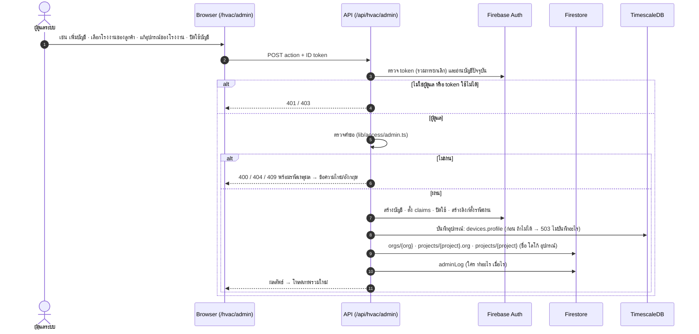

**เพิ่มลูกค้าใหม่ (ครั้งเดียวต่อลูกค้า):**

1. หน้าเว็บ: แท็บลูกค้า → **เพิ่มลูกค้า** หรือคำสั่ง `npm run org -- --org <รหัสลูกค้า> --name "<ชื่อลูกค้า>"` สร้าง `orgs/{org}` ใน Firestore
   - รหัสลูกค้าใช้ตัวพิมพ์เล็ก ตัวเลข และ `-` เหมือนรหัสโปรเจค เช่น `acme` หน้าเว็บเสนอรหัสจากชื่อให้ และเตือนถ้าชื่อซ้ำกับลูกค้าอื่น

**เพิ่มโปรเจคใหม่:**

1. ทีมคลาวด์กำหนดรหัส project และ gateway แล้วสร้าง username/password ของ PLC แต่ละตัวใน EMQX พร้อมสิทธิ์เฉพาะ topic ของตัวเอง
2. ตั้งทะเบียนโรงงานและอุปกรณ์: หน้าเว็บ แท็บโรงงาน → **เพิ่มโรงงาน** (หรือ **ตั้งทะเบียน** ถ้า PLC ส่งข้อมูลมาก่อนแล้ว ซึ่งจะแสดงอุปกรณ์ที่ส่งข้อมูลมาให้กด **เพิ่มทั้งหมด**) แล้วกรอกตารางอุปกรณ์หรือนำเข้า JSON หรือเขียนไฟล์ทะเบียน (JSON) แล้วสั่ง `npm run registry -- --file <ไฟล์>`
   1. ตรวจรายการ เช่น รหัสซ้ำ, ชนิดอุปกรณ์, รุ่นที่ไม่รู้จักหรือไม่ตรงชนิด และมิเตอร์ที่วัด chiller ที่ไม่มี (หน้าเว็บชี้ช่องที่ต้องแก้)
   2. เขียนรุ่นอุปกรณ์ลง `devices.profile` ใน TimescaleDB เพื่อแปลง fault word เป็น alarm ถ้าฐานข้อมูลใช้งานไม่ได้ จะหยุดตรงนี้โดยไม่บันทึกอะไร
   3. เขียน `projects/{project}` ใน Firestore เพื่อให้หน้าเว็บวาดผังตามนี้ทันที (ถ้าเอกสารมี `org` อยู่แล้ว ค่านี้คงเดิม) และบันทึกลง `adminLog` ว่าเพิ่ม เอาออก หรือแก้อุปกรณ์ตัวไหน
3. ผูกโปรเจคกับลูกค้า: หน้าเว็บ (ปุ่ม **โรงงาน** ของลูกค้า) หรือ `npm run org -- --org <ลูกค้า> --project <project>`
   - ผู้ใช้ทุกคนของลูกค้านั้นเห็นโรงงานใหม่ในเมนูทันที ไม่ต้องแก้บัญชีใคร
   - ต้องตั้งทะเบียน (ข้อ 2) ก่อน รหัสโปรเจคที่พิมพ์ผิดจึงถูกปฏิเสธ
   - โปรเจคที่ผูกกับลูกค้าอื่นอยู่จะถูกย้าย (หน้าเว็บบอกก่อนบันทึก) ใช้ `--remove <project>` เพื่อถอนออกจากลูกค้า
4. ตั้งค่า Modbus ของแต่ละอุปกรณ์: หน้าเว็บ แท็บโรงงาน → ปุ่ม **Modbus** (gateway, พอร์ต, slave ID, โมดูล, register ที่ต่างจากรุ่น) แล้ว **ส่งออก CSV** ให้ผู้เขียนโปรแกรม PLC
5. ผู้เขียนโปรแกรม PLC ทำตาม CSV และ `TELEMETRY.md` แล้วตรวจด้วย `npm run tap`

**เพิ่มผู้ใช้:**

1. สร้างบัญชีพร้อมสิทธิ์: หน้าเว็บ แท็บบัญชี → **เพิ่มบัญชี** หรือ `npm run access -- --email <อีเมล> --create --org <ลูกค้า>`
   - บัญชีใหม่ยังไม่มีรหัสผ่าน
   - กรณียกเว้นที่ให้ดูเฉพาะโรงงานเดียว (เช่น ผู้รับเหมา) เลือกโรงงานรายตัว หรือ `--project <project>` แทน
   - ทีมดูแลระบบ: เลือก "ผู้ดูแลระบบ" หรือ `--admin yes`
   - หน้าเว็บเตือนเมื่อโรงงานรายตัวซ้ำกับที่ได้ผ่านลูกค้าอยู่แล้ว
2. ให้ผู้ใช้ตั้งรหัสผ่าน: **ส่งอีเมลตั้งรหัสผ่าน** (อีเมลของ Firebase Authentication ในภาษาของหน้าเว็บขณะนั้น) หรือ **สร้างลิงก์ตั้งรหัสผ่าน** แล้วส่งเอง (`--reset-link` ในคำสั่ง)
3. ผู้ใช้ตั้งรหัสผ่านแล้ว login
4. ตรวจภาพรวม: แท็บบัญชี หรือ `npm run access -- --list` และ `npm run org -- --org <ลูกค้า>`

**ถอนสิทธิ์และปิดใช้บัญชี:**

- **ถอนสิทธิ์** (เอาลูกค้าหรือโรงงานออกจากบัญชี): ผู้ใช้ที่เปิดหน้าเว็บค้างไว้จะถูกตัดเมื่อ token ต่ออายุ (ไม่เกิน 1 ชั่วโมง)
- **ปิดใช้บัญชี** (หน้าเว็บ ปุ่ม **ปิดใช้** หรือ `--disabled yes`):
  - login และต่ออายุ token ไม่ได้
  - `/api/hvac/*` ปฏิเสธทันที เพราะตรวจการยกเลิก token ทุกครั้ง
  - ค่าสดจาก Firestore บนหน้าจอที่เปิดค้างไว้ยังอยู่ได้จนกว่า token หมดอายุ (ไม่เกิน 1 ชั่วโมง) เพราะ `firestore.rules` ตรวจได้แค่ token
- **เปิดใช้อีกครั้ง:** ปุ่ม **เปิดใช้** หรือ `--disabled no`

**ข้อจำกัด:** claims ของบัญชีหนึ่งรวมกันได้ไม่เกิน 1000 byte (`access` แจ้งก่อนบันทึก) สิทธิ์ผ่านลูกค้าใช้พื้นที่น้อยมาก จึงใช้ `projects` เฉพาะกรณียกเว้น

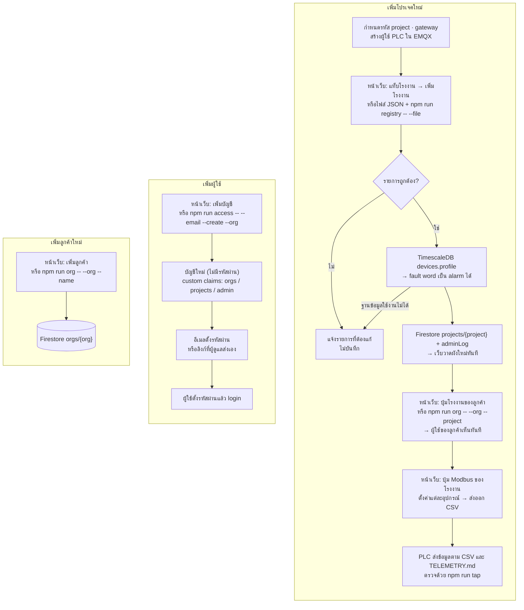

## B14. การจำลอง

**หน้าที่:** ใช้ทดสอบระบบโดยไม่มี PLC จริง มี 2 ตัวจำลองที่ใช้แบบจำลองโรงงานชุดเดียวกัน (`pdm-app/src/lib/hvac/sim.ts`)

**Virtual PLC (ทดสอบทั้งเส้นทาง):**

1. อ่านไฟล์ fleet ว่ามีโปรเจคไหน PLC กี่ตัว ต่ออุปกรณ์อะไรบ้าง
2. PLC จำลองแต่ละตัวเชื่อม broker พร้อม Last Will แล้วส่ง status `online`
3. ทุกขอบรอบ ให้สร้าง telemetry
   1. คำนวณสภาพโรงงาน ณ เวลานั้น (เลื่อนเวลาต่างกันในแต่ละ PLC)
   2. แปลงเป็น point ตามสเปก รวมถึง fault word แบบ Carrier
   3. ใส่ความผิดปกติ: อุปกรณ์ไม่ตอบ 1% และอ่านค่าไม่ได้ 0.2%
4. ทุก 5 วินาที ตรวจว่า state, code หรือ bits เปลี่ยนไหม ถ้าเปลี่ยนให้ส่ง event
5. ส่งต่อไปตามเส้นทางจริงทั้งหมด (EMQX หรือ broker ในเครื่อง → ingestion → ฐานข้อมูล → เว็บ)

**เว็บโหมดจำลอง (`NEXT_PUBLIC_HVAC_SOURCE=sim`):**

1. **ข้อมูล:** เว็บคำนวณข้อมูลจาก `sim.ts` ใน browser เอง ไม่ใช้ cloud และไม่ต้อง login
2. **ประวัติ:** trend, รายงาน และพลังงาน สร้างจากตัวจำลองย้อนหลัง
3. **เหตุการณ์ตามสคริปต์:**
   - compressor fault, ปั๊ม trip และตู้ควบคุมขาดการสื่อสาร เกิดวันละ 0 ถึง 2 ครั้ง
   - ไส้กรอง AHU-3 ตันทุกวันจันทร์
4. **ปุ่ม "เดโม":** จำลองการขาดการเชื่อมต่อ

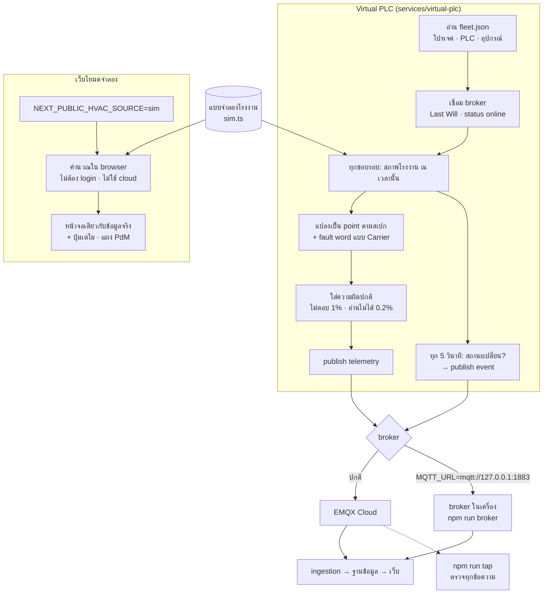

## B15. เว็บไซต์และฟอร์มขอเดโม

**หน้าที่:** ส่วนอื่นของเว็บที่ไม่เกี่ยวกับข้อมูลหน้างาน

**ขั้นตอน:**

1. **เว็บไซต์ (`/`):** หน้าแนะนำผลิตภัณฑ์ ภาษาไทยและอังกฤษ
2. **ฟอร์มขอเดโม:** ตรวจข้อมูลฝั่ง server (server action)
   - **ผ่าน:** บันทึกลง Firestore `demoRequests` ถ้าตั้ง `LEADS_NOTIFY_EMAIL` จะสร้างเอกสารใน `mail` ด้วย เพื่อให้ส่วนขยาย Trigger Email ส่งอีเมลแจ้งทีมขาย
   - **ไม่ผ่าน:** แจ้งข้อผิดพลาดที่ฟอร์ม
3. **แอป PdM (`/app`):** ใช้ข้อมูลจำลองของเครื่องจักร 50 เครื่องเสมอ ยังไม่ได้ต่อข้อมูลจริง

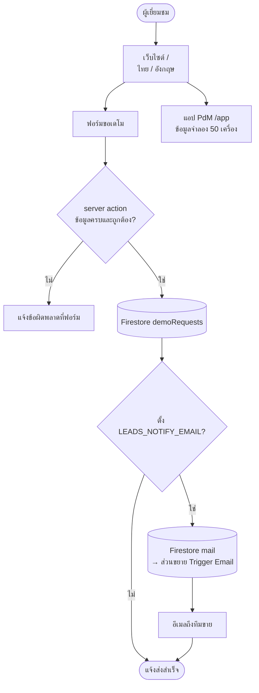

## B16. อีเมลแจ้งเตือน alarm

**หน้าที่:** ส่งอีเมลเมื่อเกิด alarm ที่โรงงาน ให้ผู้รับที่ผู้ดูแลตั้งไว้ โดยไม่ต้องมีใครเปิดหน้าจอค้างไว้

**ขั้นตอน:**

1. **ผู้ดูแลตั้งค่า:** หน้า `/hvac/admin` แท็บโรงงาน ปุ่ม "การแจ้งเตือน" แล้วตั้งค่าต่อไปนี้ (บันทึกที่ `notifyConfig/{project}` ผ่าน API และลงบันทึกการเปลี่ยนแปลง):
   - เปิดหรือปิด
   - ผู้รับไม่เกิน 20 อีเมล
   - ระดับ: ทุกระดับ หรือเฉพาะวิกฤต
   - แจ้งตอน alarm หาย
   - ภาษาไทยหรืออังกฤษ
   - กด "ส่งอีเมลทดสอบ" ได้ทันที API เขียนลง `mail` เอง ไม่ต้องรอ ingestion
2. **ตัวส่งใน ingestion (`services/ingest/src/notify.ts`, เปิดด้วย `NOTIFY_EMAIL=on`):** ฟัง `notifyConfig` และเอกสารสดของโรงงานที่เปิดไว้ (ทะเบียน, gateways, alarms, commAcks)
3. **ทุก 1 นาที:** คำนวณ alarm ที่ยังเกิดอยู่ด้วยฟังก์ชันเดียวกับหน้าจอ (`liveAlarms` ใน `pdm-app/src/lib/hvac/live-alarms.ts`) รหัสและสถานะรับทราบจึงตรงกับที่ผู้ใช้เห็น
4. **ใช้กฎลดข้อความ (`pdm-app/src/lib/notify/decide.ts`):**
   - alarm ใหม่ที่ผ่านระดับที่ตั้งไว้: fault ส่งทันที alarm การสื่อสารต้องค้างเกิน 5 นาที และไม่ส่งถ้ามีคนรับทราบไปแล้ว
   - alarm วิกฤตที่ส่งไปแล้วแต่ไม่มีใครรับทราบใน 30 นาที: ส่งซ้ำ 1 ครั้ง
   - alarm ที่เคยส่งแล้วหายไป: ส่งแจ้งหาย (ถ้าตั้งไว้) แล้วลบออกจากรายการ
   - ทุกอย่างของโรงงานในรอบเดียวรวมเป็นอีเมลเดียว
5. **เขียนใน transaction เดียว:** อ่าน `notifyState/{project}` ตัดสินใจอีกครั้ง แล้วเขียนอีเมล 1 ฉบับต่อผู้รับลง `mail` (ลบอัตโนมัติด้วย `deleteAfter` หลัง 30 วัน) พร้อมสถานะใหม่
   - รีสตาร์ต ingestion หรือรันพร้อมกันหลายตัวก็ไม่ส่งซ้ำ
   - ปิดการแจ้งเตือนของโรงงานจะลบ `notifyState` ทิ้ง เปิดใหม่จึงเริ่มจากศูนย์
6. **extension "Trigger Email from Firestore"** ส่งอีเมลผ่าน SMTP ที่ตั้งไว้ และเขียนผลการส่งกลับในเอกสาร `mail` (field `delivery`)
7. **ดูสถานะได้ที่ `/healthz` ของ ingestion:** `alarmEmails` = จำนวนโรงงาน, อีเมลที่เข้าคิว, รอบล่าสุด, error ล่าสุด

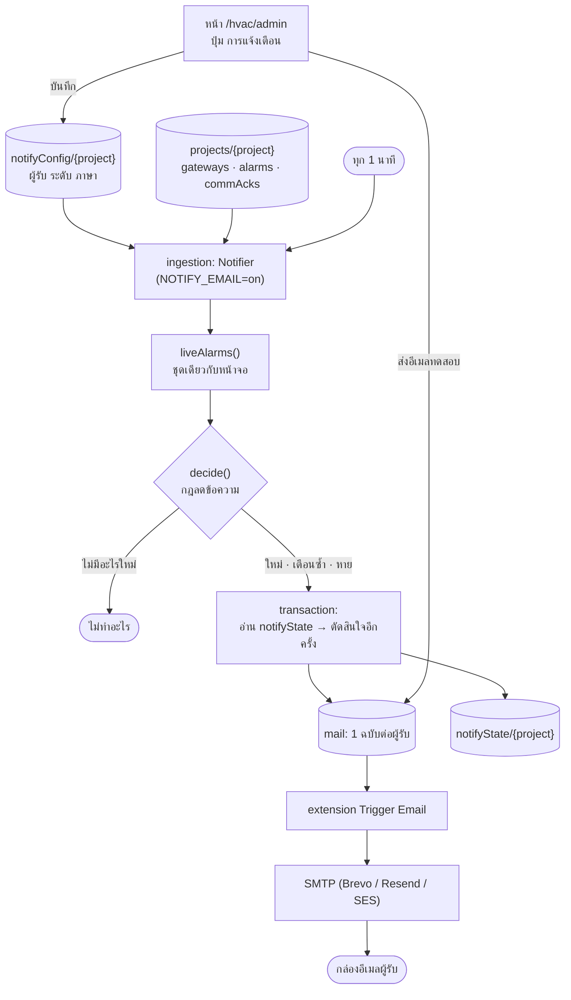
