# คู่มือเพิ่มโรงงานใหม่

ขั้นตอนตั้งแต่รับโปรเจคใหม่ ติดตั้ง PLC ที่หน้างาน จนลูกค้าเปิดดูโรงงานของตัวเองได้ ใช้ได้ทั้งช่างหน้างานและผู้ดูแลระบบ ภาพทุกภาพมาจากการจำลองโรงงานตัวอย่าง `demo-plant` ด้วย PLC จำลอง (วิธีซ้อมแบบเดียวกันอยู่ใน[ส่วน F](#ส่วน-f-ซ้อมในเครื่องด้วย-plc-จำลอง))

- **สเปกสำหรับคนเขียนโปรแกรม PLC:** [`TELEMETRY.md`](TELEMETRY.md)
- **การทำงานของระบบเบื้องหลัง:** [`FLOW.md`](FLOW.md) หัวข้อ B13
- **คำสั่งของผู้ดูแลระบบและการ deploy:** [`DEPLOY.md`](DEPLOY.md)

## ภาพรวม

**ข้อมูลเข้าระบบเองได้ แต่ลูกค้ายังเห็นไม่ได้จนกว่าจะตั้งทะเบียน**

- **ส่วนที่เข้ามาเอง:** เมื่อ PLC เชื่อมต่อได้และส่งข้อมูลตามสเปก ระบบเก็บค่าของทุกอุปกรณ์ทันทีโดยไม่ต้องลงทะเบียนก่อน ข้อมูลตั้งแต่วันแรกจึงไม่หาย
- **ส่วนที่ต้องเพิ่มเอง:** ข้อความจาก PLC มีแค่รหัสอุปกรณ์กับค่าที่อ่านได้ คนจึงต้องบอกระบบว่าอุปกรณ์แต่ละตัวคืออะไร (ประเภท ชื่อ ขนาด รุ่น) และโรงงานเป็นของลูกค้ารายไหน
- **ส่วนที่ระบบช่วย:** รหัสโปรเจคและอุปกรณ์ที่ส่งข้อมูลมาแล้ว ขึ้นให้กดเลือกในหน้าผู้ดูแลระบบ ไม่ต้องพิมพ์เอง

| ส่วน | ใครทำ | ทำอะไร | ใช้เวลาโดยประมาณ |
|---|---|---|---|
| [A. ก่อนลงหน้างาน](#ส่วน-a-ก่อนลงหน้างาน) | ผู้ดูแลระบบ | กำหนดรหัส สร้างบัญชีของ PLC ใน EMQX เตรียมใบงานให้ช่าง | 15 นาที |
| [B. ที่หน้างาน](#ส่วน-b-ที่หน้างาน) | ช่างหน้างาน | ตั้งค่า PLC จดข้อมูลอุปกรณ์ แจ้งผู้ดูแลตรวจว่าข้อมูลขึ้น | ตามงานติดตั้ง |
| [C. หลังติดตั้ง](#ส่วน-c-หลังติดตั้ง-ผู้ดูแลระบบ) | ผู้ดูแลระบบ | ตั้งทะเบียนโรงงาน ผูกกับลูกค้า เพิ่มบัญชีผู้ใช้ | 10 นาที |
| [D. ตรวจก่อนส่งมอบ](#ส่วน-d-ตรวจก่อนส่งมอบ) | ผู้ดูแลระบบกับช่าง | ตรวจค่าบนหน้าจอเทียบกับหน้างาน แล้วส่งมอบให้ลูกค้า | 15 นาที |
| [E. เพิ่มภายหลัง](#ส่วน-e-เพิ่ม-plc-หรืออุปกรณ์ภายหลัง) | ทั้งสองฝ่าย | เพิ่ม PLC หรืออุปกรณ์ในโรงงานที่มีอยู่แล้ว | 5 นาที |

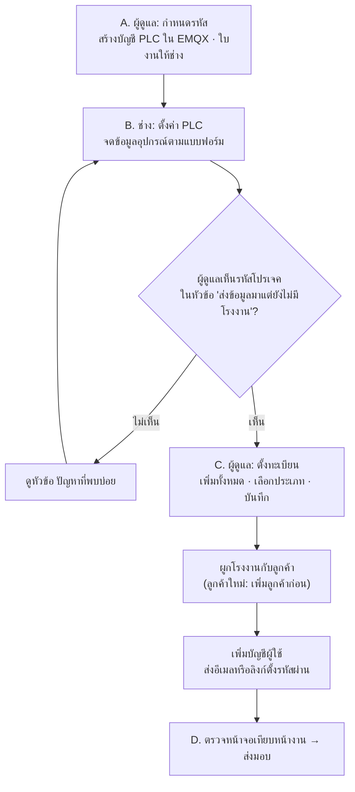

**รหัสที่ใช้เป็นตัวอย่างในคู่มือนี้**

| รายการ | ตัวอย่าง |
|---|---|
| โรงงาน (project) | `demo-plant` ชื่อ "โรงงานตัวอย่าง" |
| PLC (gateway) | `plc-01` และ `plc-02` ที่เพิ่มภายหลัง |
| อุปกรณ์ | Chiller `CH-1`, `CH-2` · ปั๊ม `CHP-1`, `CHP-2` · AHU `AHU-1`, `AHU-2` · มิเตอร์ `PM-CH-1`, `PM-CH-2` · ตู้ควบคุม `CP-1` |
| ลูกค้า | `demo-co` ชื่อ "บริษัท ตัวอย่าง จำกัด" |
| ผู้ใช้ของลูกค้า | `somchai@demo-co.test` |

---

## ส่วน A: ก่อนลงหน้างาน

ผู้ดูแลระบบทำก่อนช่างออกไปติดตั้ง เพราะ PLC ต้องมีรหัสและบัญชีก่อนจึงจะเชื่อมต่อได้

### A1. กำหนดรหัส

| รหัส | รูปแบบ | ตัวอย่าง | หมายเหตุ |
|---|---|---|---|
| โรงงาน (project) | a-z, 0-9, `-` ยาวไม่เกิน 32 | `demo-plant` | เปลี่ยนภายหลังไม่ได้ ทุก PLC ของโรงงานเดียวกันใช้รหัสนี้ |
| PLC (gateway) | a-z, 0-9, `-` ยาวไม่เกิน 32 | `plc-01` | ไม่ซ้ำกันภายในโรงงาน |
| อุปกรณ์ | A-Z, a-z, 0-9, `-`, `_` ยาวไม่เกิน 32 ห้ามมีจุด | `CH-1` | ช่างตั้งตามป้ายหน้างาน ห้ามซ้ำกันทั้งโรงงานแม้ต่อกับ PLC คนละตัว |

- **รหัสอุปกรณ์ต้องคงที่ตลอดอายุการใช้งาน:** ถ้าเปลี่ยนรหัส ระบบจะถือเป็นอุปกรณ์ใหม่ และประวัติจะแยกเป็นสองชุด
- **ย้ายอุปกรณ์ไปต่อ PLC ตัวอื่นได้:** ถ้าใช้รหัสเดิมในโรงงานเดียวกัน ประวัติยังต่อเนื่อง

### A2. สร้างบัญชีของ PLC ใน EMQX

ทำใน EMQX Cloud console ของ deployment `pdm-app` (ชื่อเมนูอาจต่างเล็กน้อยตามรุ่นของ console)

1. **Access Control → Authentication:** เพิ่ม username และ password ให้ PLC แต่ละตัว เช่น username `demo-plant.plc-01` และรหัสผ่านที่สุ่มยาว
2. **Access Control → Authorization:** เพิ่มกฎของ username นั้น ให้ **Publish** ได้เฉพาะ `pdm/v1/demo-plant/plc-01/#` (กฎ All Users ที่ปิดทุก topic ไว้ยังคงอยู่)
3. ส่ง username/password ให้ช่างทางช่องทางส่วนตัว ห้ามใส่ในเอกสารหรือกลุ่มแชท

### A3. ใบงานสำหรับช่าง

คัดลอกตารางนี้ แล้วเติมค่าของโรงงานนั้น (รายละเอียดเต็มอยู่ใน [`TELEMETRY.md`](TELEMETRY.md) ข้อ 1)

| ค่า | ใส่ใน PLC |
|---|---|
| Broker | `vcc22b2f.ala.asia-southeast1.emqxsl.com` พอร์ต `8883` (TLS เท่านั้น) |
| TLS | TLS 1.2 ขึ้นไป และ**ต้องส่ง SNI** ถ้าไม่ส่ง จะถูกปฏิเสธเป็น "Not Authorized" แม้รหัสผ่านถูก |
| CA | DigiCert Global Root CA (ห้ามฝังใบรับรองของเซิร์ฟเวอร์เอง) |
| Client ID | `demo-plant.plc-01` |
| Username / Password | ตามที่ผู้ดูแลส่งให้ |
| Topic | `pdm/v1/demo-plant/plc-01/telemetry`, `.../event`, `.../status` |
| Last Will | topic `pdm/v1/demo-plant/plc-01/status`, payload `{"v":1,"state":"offline"}`, QoS 1, retain |
| รอบการส่ง | 60 วินาที (ช้ากว่านี้ได้) |
| นาฬิกา | ซิงก์ NTP อย่างน้อยวันละครั้ง |

### A4. ตรวจรุ่นอุปกรณ์

- **รุ่นที่ระบบรู้จักแล้ว:** Carrier 30RAM/RHM-X modular chiller ระบบแปลง fault ของรุ่นนี้เป็น alarm ที่มีชื่อได้
- **รุ่นอื่น:** ขอ register map จากผู้ผลิตแล้วส่งให้ทีมพัฒนาเพิ่ม profile ก่อน ถ้าไม่มี profile ค่าต่างๆ ยังเข้าระบบได้ แต่ fault จะไม่ถูกแปลงเป็น alarm
- **อุปกรณ์ที่รองรับ:** Chiller, ปั๊ม, AHU, OAU, มิเตอร์ไฟฟ้า และตู้ควบคุม (tag list ของแต่ละประเภทอยู่ใน [`TELEMETRY.md`](TELEMETRY.md) ข้อ 9)

---

## ส่วน B: ที่หน้างาน

### B1. ตั้งค่า PLC

1. ใส่ค่าจากใบงานข้อ A3
2. ตั้งรหัสอุปกรณ์ตามป้ายหน้างาน ตามรูปแบบในข้อ A1
3. map register ของอุปกรณ์เข้ากับ point ตาม tag list ใน [`TELEMETRY.md`](TELEMETRY.md) ข้อ 9

### B2. จดข้อมูลอุปกรณ์

ผู้ดูแลต้องใช้ข้อมูลนี้ตั้งทะเบียนในส่วน C คัดลอกตารางไปกรอก 1 แถวต่ออุปกรณ์ 1 ตัว:

| รหัสอุปกรณ์ (ใน PLC) | PLC | ประเภท | ชื่อที่ลูกค้าเรียก | ยี่ห้อ / รุ่น | ขนาด (ตัน) | ปั๊ม: duty / standby | มิเตอร์: วัดเครื่องไหน | หมายเหตุ |
|---|---|---|---|---|---|---|---|---|
| CH-1 | plc-01 | Chiller | CHILLER-1 | Carrier 30RAM | 120 | | | |
| CHP-1 | plc-01 | ปั๊ม | CHP-1 | | | duty | | |
| PM-CH-1 | plc-01 | มิเตอร์ไฟฟ้า | Power Meter-1 | | | | CH-1 | |
| CP-1 | plc-01 | ตู้ควบคุม | Control Kit | | | | | |
| | | | | | | | | |

- **ชื่อที่ลูกค้าเรียก:** ไม่กรอกก็ได้ ระบบจะใช้รหัสอุปกรณ์แทน
- **ลำดับแถว:** เรียงตามที่อยากให้แสดงบนจอ ปรับภายหลังได้

### B3. แจ้งผู้ดูแลตรวจว่าข้อมูลขึ้นคลาวด์

เมื่อ PLC ต่อเน็ตได้ ให้โทรหรือส่งข้อความหาผู้ดูแลระบบ ผู้ดูแลตรวจได้ 2 ทาง:

- **หน้าเว็บ:** `/hvac/admin` → แท็บ **โรงงาน** รหัสโปรเจคต้องขึ้นในหัวข้อ "ส่งข้อมูลมาแต่ยังไม่มีโรงงาน" (ภาพในข้อ C1)
- **ตัวตรวจ (tap):** สั่ง `npm run tap` ในโฟลเดอร์ `services/virtual-plc` ตัวตรวจจะแสดงทุกข้อความที่ผ่าน broker และบอกว่าผ่านสเปกหรือไม่ ตัวอย่างจากการจำลอง:

  ```
  Listening on mqtt://127.0.0.1:1883 for pdm/v1/#
  ✓ demo-plant/plc-01 status online (retained) fw=virtual-plc/0.1.0
  ✓ demo-plant/plc-01 telemetry 14:41:50 seq=64 devices=9 points=156 null=3 2.0 KB
  ✓ demo-plant/plc-01 telemetry 14:42:00 seq=65 devices=9 points=156 null=3 2.0 KB
  ```

  - `status online` แปลว่า PLC เชื่อมต่อแล้ว
  - `devices=9` ต้องเท่ากับจำนวนอุปกรณ์ที่ต่อจริง
  - ถ้ามี `no-answer=...` แปลว่าอุปกรณ์ตัวนั้นไม่ตอบ Modbus ให้ตรวจสายและ address
  - ถ้าขึ้น `✗` แปลว่าคลาวด์จะไม่รับข้อความนั้น ให้แก้ตามสาเหตุที่บอก

ส่งแบบฟอร์มจากข้อ B2 ให้ผู้ดูแลเมื่อข้อมูลขึ้นครบ

---

## ส่วน C: หลังติดตั้ง (ผู้ดูแลระบบ)

ทำบนหน้าเว็บ `/hvac` ด้วยบัญชีผู้ดูแลระบบ เมนู **ลูกค้า โรงงาน และบัญชี** (บัญชีอื่นไม่เห็นเมนูนี้) ถ้าหน้านี้ยังไม่ได้ deploy ให้ใช้คำสั่งในหัวข้อ [ทำด้วยคำสั่งแทนหน้าเว็บ](#ทำด้วยคำสั่งแทนหน้าเว็บ)

### C1. ดูว่าโรงงานส่งข้อมูลเข้ามาแล้ว

แท็บ **โรงงาน**: รหัสโปรเจคที่ PLC ส่งข้อมูลมาแต่ยังไม่มีทะเบียน จะขึ้นในหัวข้อ "ส่งข้อมูลมาแต่ยังไม่มีโรงงาน"

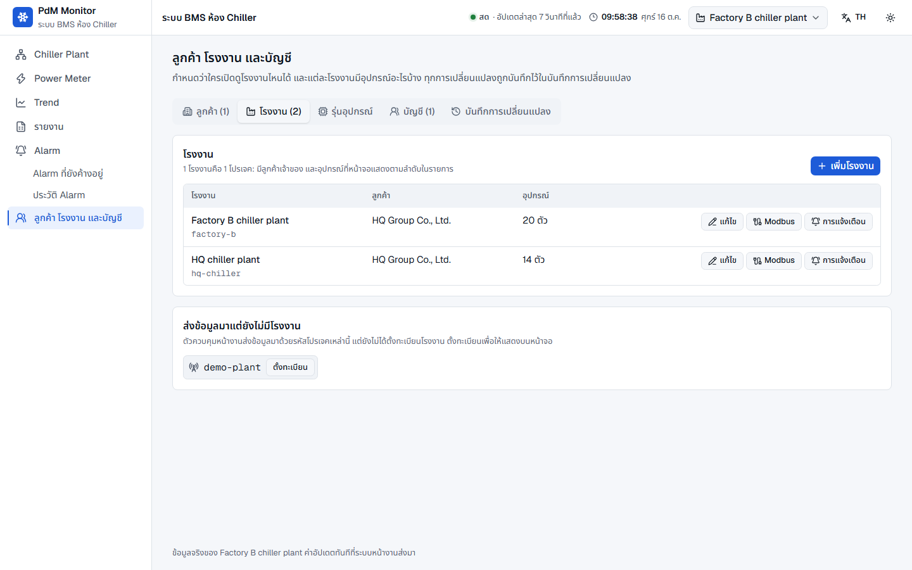

### C2. ตั้งทะเบียนโรงงาน

1. กด **ตั้งทะเบียน** ข้างรหัสโปรเจค หน้าต่างตั้งทะเบียนจะแสดงอุปกรณ์ที่ส่งข้อมูลมาแล้ว พร้อมชื่อ PLC ที่ส่งมา

   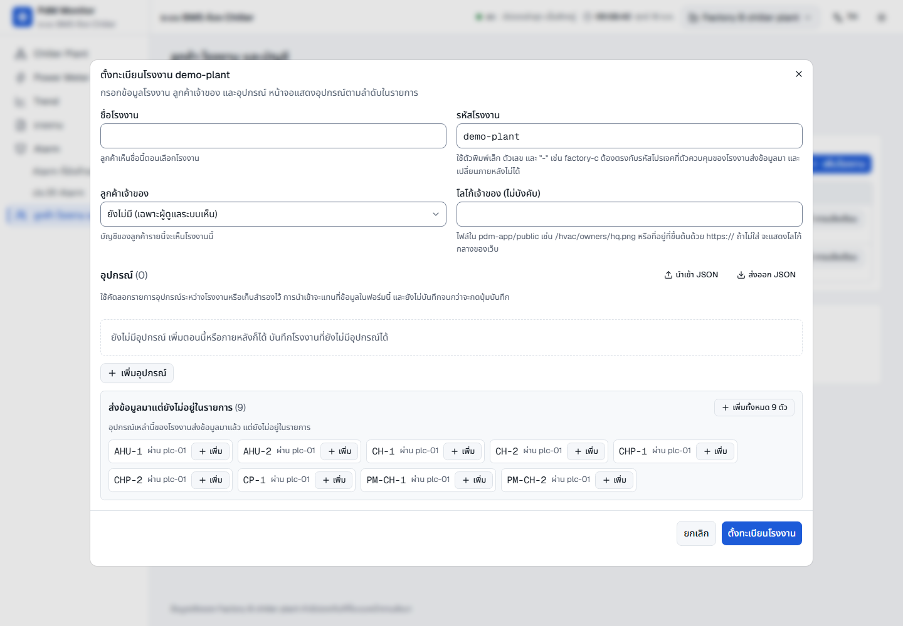

2. ตรวจว่าจำนวนอุปกรณ์ตรงกับแบบฟอร์มของช่าง แล้วกด **เพิ่มทั้งหมด** (หรือ **เพิ่ม** ทีละตัว)
3. กรอก **ชื่อโรงงาน** ที่ลูกค้าจะเห็น เลือก **ลูกค้าเจ้าของ** และใส่โลโก้เจ้าของ (ไม่บังคับ)
   - **ลูกค้ายังไม่มีในระบบ:** เว้นช่องลูกค้าเจ้าของไว้ก่อน แล้วผูกในข้อ C4 ถึง C5
4. กรอกแต่ละแถวตามแบบฟอร์มของช่าง

   | ช่อง | กรอกอะไร |
   |---|---|
   | ประเภท | บังคับทุกแถว |
   | ชื่อบนหน้าจอ | ไม่บังคับ ถ้าว่างจะแสดงรหัสอุปกรณ์ |
   | ป้ายสั้น | ไม่บังคับ |
   | รายละเอียด | Chiller: ขนาด (ตัน) ใช้คำนวณ % โหลด · ปั๊ม: Duty หรือ Standby · มิเตอร์: วัดเครื่องไหน |
   | รุ่นอุปกรณ์ | Chiller รุ่นที่ระบบรู้จัก เช่น Carrier 30RAM ใช้แปลง fault เป็น alarm |

5. ใช้ลูกศร ↑ ↓ เรียงลำดับที่จะแสดงบนจอ

   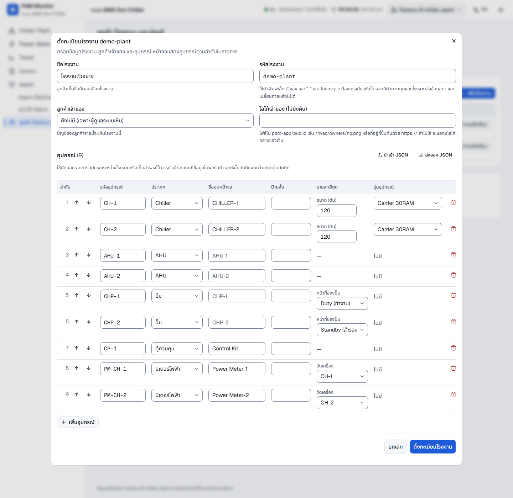

6. กด **ตั้งทะเบียนโรงงาน** ถ้ามีช่องที่ต้องแก้ หน้าต่างจะชี้ช่องนั้นและยังไม่บันทึก

- **นำเข้า JSON / ส่งออก JSON:** ใช้คัดลอกรายการอุปกรณ์ระหว่างโรงงาน เตรียมไฟล์ไว้ก่อนลงหน้างาน หรือเก็บไว้เป็นสำเนา (รูปแบบเดียวกับ `npm run registry`)
- **ถ้าขึ้นว่าฐานข้อมูลประวัติใช้งานไม่ได้:** ระบบยังไม่บันทึกอะไรเลย ให้ลองอีกครั้งภายหลัง

### C3. ตรวจผลการตั้งทะเบียน

โรงงานใหม่ขึ้นในรายการพร้อมจำนวนอุปกรณ์ ถ้าเลือกลูกค้าเจ้าของแล้ว ผู้ใช้ของลูกค้ารายนั้นเห็นโรงงานทันที ให้ข้ามไปข้อ C6 ถ้ายังไม่ได้เลือก จะขึ้นว่า "ยังไม่มีลูกค้า" ซึ่งยังไม่มีลูกค้าคนไหนเห็นโรงงานนี้

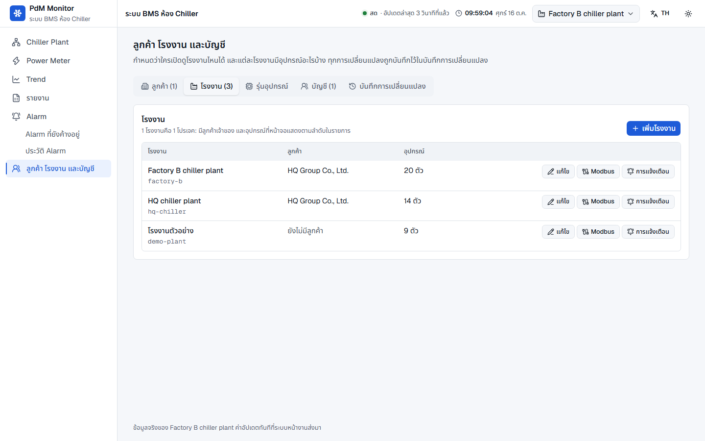

### C4. เพิ่มลูกค้า (เฉพาะลูกค้าใหม่)

ข้ามข้อนี้ถ้าลูกค้ามีอยู่แล้ว

1. แท็บ **ลูกค้า** → **เพิ่มลูกค้า**
2. ใส่ชื่อลูกค้าและรหัสลูกค้า (ตัวพิมพ์เล็ก ตัวเลข และ `-` เปลี่ยนภายหลังไม่ได้) แล้วกด **เพิ่ม**
3. หน้าต่างไปต่อที่การเลือกโรงงานของลูกค้าใหม่ทันที (ข้อ C5) หรือกด **ข้ามไปก่อน**

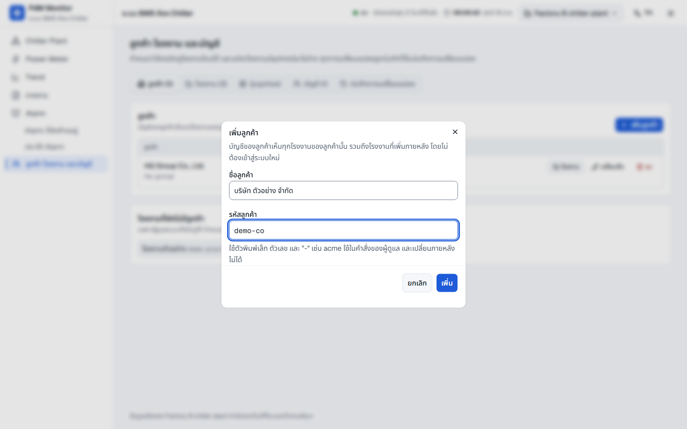

### C5. ผูกโรงงานกับลูกค้า

1. กดปุ่ม **โรงงาน** ในแถวของลูกค้า (ข้ามขั้นนี้ถ้ามาจากข้อ C4)
2. เลือกโรงงานใหม่ แล้วกด **บันทึก**

อีกทางหนึ่ง: แท็บ **โรงงาน** → ปุ่ม **แก้ไข** ของโรงงาน → ช่อง **ลูกค้าเจ้าของ** → **บันทึก**

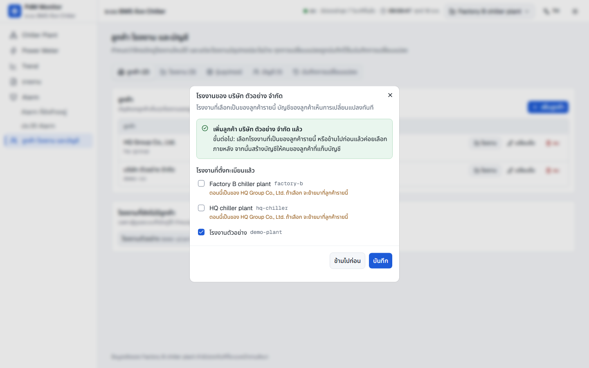

- **โรงงานที่มีเจ้าของอยู่แล้ว:** หน้าต่างจะเตือนว่าโรงงานจะถูกย้ายมาจากลูกค้ารายอื่น
- **ผู้ใช้เดิมของลูกค้าเห็นทันที:** ผู้ใช้ทุกคนของลูกค้ารายนี้เห็นโรงงานใหม่โดยไม่ต้องแก้บัญชีใคร

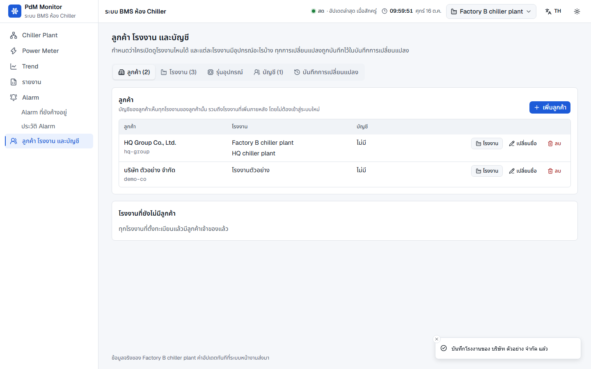

### C6. เพิ่มบัญชีผู้ใช้ (เฉพาะผู้ใช้ใหม่)

1. แท็บ **บัญชี** → **เพิ่มบัญชี**
2. ใส่อีเมล เลือกลูกค้า แล้วกด **เพิ่ม**
   - **เลือก "โรงงานรายตัว" แทนลูกค้า:** เฉพาะกรณียกเว้น เช่น ผู้รับเหมาที่ดูแลโรงงานเดียว
   - **ไม่ต้องติ๊กโรงงานรายตัวซ้ำ:** โรงงานที่ได้ผ่านลูกค้าอยู่แล้วจะขึ้นว่า "ได้อยู่แล้วผ่าน ..."

   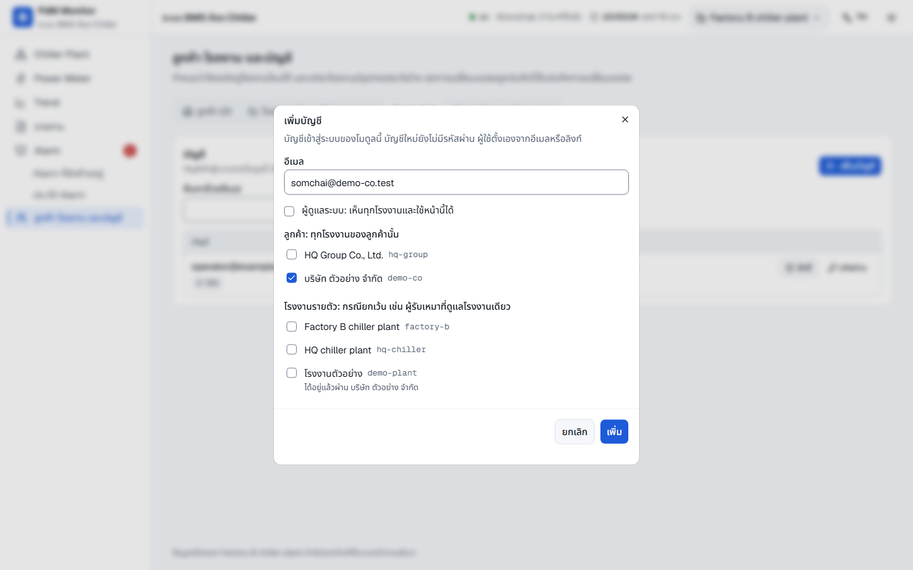

3. บัญชีใหม่ยังไม่มีรหัสผ่าน ให้เลือกวิธีให้ผู้ใช้ตั้งรหัสผ่าน
   - **ส่งอีเมลตั้งรหัสผ่าน:** ส่งในภาษาของหน้าเว็บขณะนั้น และแจ้งผู้ใช้ให้ดูโฟลเดอร์สแปมด้วย
   - **สร้างลิงก์ตั้งรหัสผ่าน:** คัดลอกลิงก์ไปส่งให้ผู้ใช้คนนั้นทางข้อความส่วนตัว ลิงก์ใช้ได้ในเวลาจำกัด

   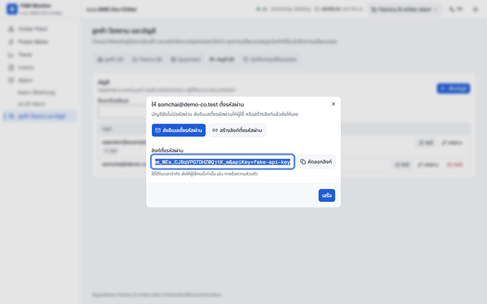

### C7. ตรวจบันทึกการเปลี่ยนแปลง

แท็บ **บันทึกการเปลี่ยนแปลง** แสดงว่าใครทำอะไรเมื่อไร ทั้งจากหน้าเว็บและจากคำสั่ง ใช้ตรวจว่าทำครบทุกขั้น

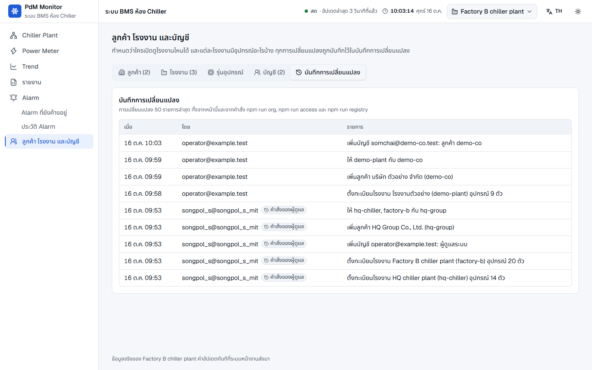

### ทำด้วยคำสั่งแทนหน้าเว็บ

ทุกขั้นในส่วน C ทำด้วยคำสั่งจากโฟลเดอร์ `services/ingest` ได้ด้วย (ใช้สิทธิ์ gcloud ของผู้ดูแล) ทั้งสองทางใช้การตรวจชุดเดียวกัน และบันทึกลงบันทึกการเปลี่ยนแปลงเหมือนกัน

| ขั้น | คำสั่ง |
|---|---|
| C2 ตั้งทะเบียน | `npm run registry -- --file demo-plant.json` |
| C4 เพิ่มลูกค้า | `npm run org -- --org demo-co --name "บริษัท ตัวอย่าง จำกัด"` |
| C5 ผูกโรงงาน | `npm run org -- --org demo-co --project demo-plant` |
| C6 เพิ่มบัญชี | `npm run access -- --email somchai@demo-co.test --create --org demo-co --reset-link` |
| C7 ตรวจ | `npm run org -- --org demo-co` และ `npm run access -- --list` |

ไฟล์ทะเบียนของโรงงานตัวอย่าง (ได้จากปุ่ม **ส่งออก JSON**):

```json
{
  "project": "demo-plant",
  "name": "โรงงานตัวอย่าง",
  "devices": [
    { "id": "CH-1", "kind": "chiller", "name": "CHILLER-1", "profile": "carrier-30ram", "capacityTon": 120 },
    { "id": "CH-2", "kind": "chiller", "name": "CHILLER-2", "profile": "carrier-30ram", "capacityTon": 120 },
    { "id": "AHU-1", "kind": "ahu" },
    { "id": "AHU-2", "kind": "ahu" },
    { "id": "CHP-1", "kind": "pump", "role": "duty" },
    { "id": "CHP-2", "kind": "pump", "role": "standby" },
    { "id": "CP-1", "kind": "panel", "name": "Control Kit" },
    { "id": "PM-CH-1", "kind": "meter", "name": "Power Meter-1", "meterFor": "CH-1" },
    { "id": "PM-CH-2", "kind": "meter", "name": "Power Meter-2", "meterFor": "CH-2" }
  ]
}
```

- **ไฟล์แทนที่ทะเบียนเดิมทั้งหมด:** อุปกรณ์ที่ไม่มีในไฟล์จะหายจากหน้าจอ แต่ข้อมูลที่เก็บไว้ยังอยู่
- **รูปแบบไฟล์เต็ม:** [`services/ingest/README.md`](services/ingest/README.md) หัวข้อ "ทะเบียนอุปกรณ์ของโปรเจค"

---

## ส่วน D: ตรวจก่อนส่งมอบ

### D1. ดูหน้าจอแบบที่ลูกค้าเห็น

เข้าสู่ระบบด้วยบัญชีของลูกค้า (หรือบัญชีผู้ดูแล แล้วเลือกโรงงานจากปุ่มบัญชีมุมขวาบน) ลูกค้าเห็นเฉพาะโรงงานของตัวเองและไม่เห็นเมนูผู้ดูแล

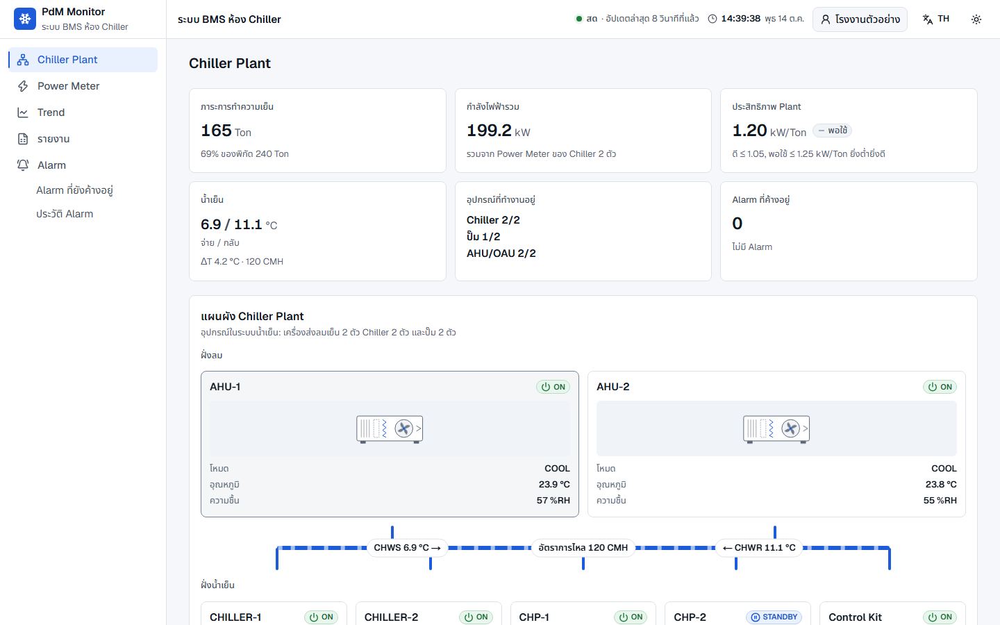

ตรวจทีละข้อ:

- [ ] ชื่อโรงงานถูกต้อง และอุปกรณ์ขึ้นครบตามแบบฟอร์มของช่าง
- [ ] ไม่มีหมวด "อุปกรณ์ที่ยังไม่อยู่ในรายชื่อ" ท้ายหน้า (ถ้ามี ดูข้อ E2)
- [ ] สถานะเดินหรือหยุดตรงกับหน้างาน และปั๊มที่เป็น Standby ขึ้นถูกตัว
- [ ] ค่าอุณหภูมิ อัตราการไหล และกำลังไฟตรงกับหน้าจอที่ตู้ควบคุม
- [ ] หน้า Power Meter: มิเตอร์แต่ละตัวผูกกับ chiller ถูกเครื่อง

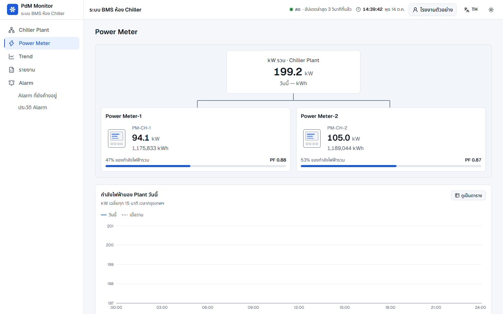

- **กราฟและรายงานยังว่างในช่วงแรก:** กราฟกำลังไฟใช้ค่าเฉลี่ยทุก 15 นาที และรายงานแสดงเฉพาะช่วงที่มีข้อมูลแล้ว เป็นอาการปกติของโรงงานใหม่
- **ทดสอบ alarm (ถ้าทำได้):** ให้ช่างจำลอง fault ที่ตู้ควบคุม แล้วตรวจว่า alarm ขึ้นในหน้า Alarm ที่ยังค้างอยู่

### D2. ส่งมอบให้ลูกค้า

1. แจ้งลูกค้าว่าจะได้รับอีเมลหรือลิงก์ตั้งรหัสผ่าน (ใช้ได้ในเวลาจำกัด ถ้าหมดอายุ ให้ผู้ดูแลกดปุ่ม **รหัสผ่าน** ของบัญชีนั้นเพื่อสร้างใหม่)
2. ผู้ใช้ตั้งรหัสผ่าน แล้วเข้าสู่ระบบที่หน้า `/hvac`
3. ผู้ใช้เดิมที่ได้สิทธิ์เพิ่ม ให้กด **ตรวจอีกครั้ง** ในหน้าเว็บ หรือออกจากระบบแล้วเข้าใหม่

---

## ส่วน E: เพิ่ม PLC หรืออุปกรณ์ภายหลัง

### E1. เพิ่ม PLC ตัวใหม่ในโรงงานเดิม

1. ผู้ดูแลกำหนดรหัส PLC ใหม่ เช่น `plc-02` แล้วสร้างบัญชีใน EMQX ตามข้อ A2 (topic `pdm/v1/demo-plant/plc-02/#`)
2. ช่างตั้งค่า PLC ตามข้อ B1 โดยใช้รหัสโรงงานเดิม
3. ทำข้อ E2 ต่อเพื่อเพิ่มอุปกรณ์ที่ต่อกับ PLC ตัวใหม่

### E2. เพิ่มอุปกรณ์ที่ส่งข้อมูลมาแต่ยังไม่อยู่ในรายการ

ลูกค้าจะเห็นอุปกรณ์ใหม่แยกอยู่ในหมวด "อุปกรณ์ที่ยังไม่อยู่ในรายชื่อ" พร้อมค่าดิบ อุปกรณ์ในหมวดนี้ยังไม่อยู่ในผัง และยังไม่ถูกนับในยอดรวม

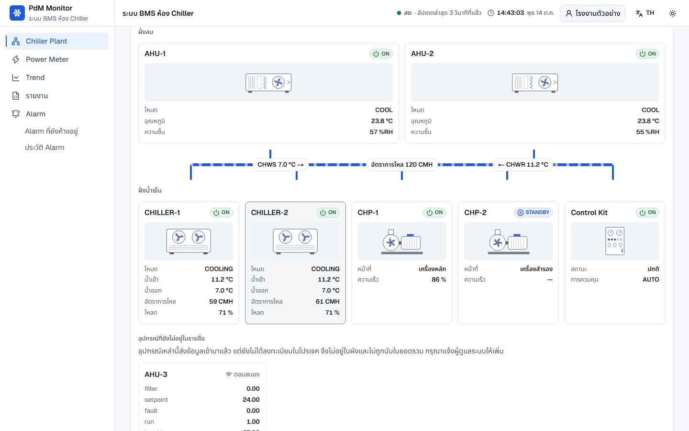

1. ผู้ดูแลเปิดแท็บ **โรงงาน** → ปุ่ม **แก้ไข** ของโรงงานนั้น
2. อุปกรณ์ใหม่ขึ้นในหัวข้อ "ส่งข้อมูลมาแต่ยังไม่อยู่ในรายการ" พร้อมชื่อ PLC ที่ส่งมา กด **เพิ่ม**

   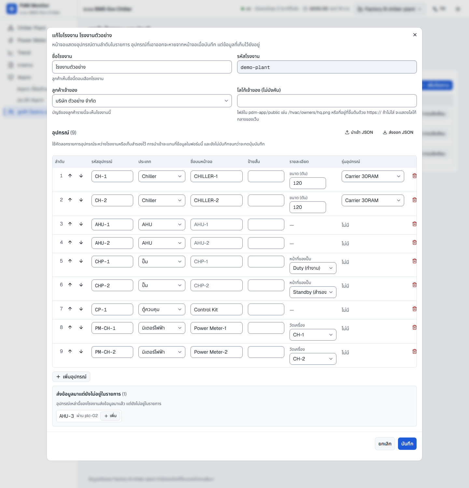

3. เลือกประเภท เลื่อนลำดับ แล้วกด **บันทึก** หน้าจอของลูกค้าอัปเดตเองทันที

- **เอาอุปกรณ์ออก:** กดถังขยะในแถวนั้นแล้วบันทึก อุปกรณ์จะหายจากหน้าจอ แต่ประวัติยังอยู่
- **เปลี่ยนชื่อที่แสดง:** แก้ได้ทุกเมื่อ ไม่กระทบประวัติ (อย่าเปลี่ยนรหัสอุปกรณ์ใน PLC)

---

## ส่วน F: ซ้อมในเครื่องด้วย PLC จำลอง

ใช้ซ้อมขั้นตอนทั้งหมดก่อนลงหน้างานจริง หรืออบรมผู้ดูแลคนใหม่ วิธีนี้ไม่แตะ EMQX และ Firebase จริง แต่ **ingestion ยังเขียนข้อมูลของ `demo-plant` ลง TimescaleDB ตัวจริง (`pdm-dev`)** และการตั้งทะเบียนก็เขียนรุ่นอุปกรณ์ลงที่เดียวกัน

ไฟล์ [`services/virtual-plc/fleet.demo-plant.json`](services/virtual-plc/fleet.demo-plant.json) คือโรงงานตัวอย่างในคู่มือนี้ (PLC 1 ตัว อุปกรณ์ 9 ตัว) ซึ่งมีแค่รหัสกับประเภทเหมือน PLC จริง

เปิดแต่ละโปรแกรมใน terminal แยกกัน คำสั่งเป็นของ Git Bash และเริ่มจากโฟลเดอร์หลักของโปรเจค

1. **Firebase emulator** (Firestore และ Authentication):

   ```bash
   cd pdm-app && npx firebase-tools@13 emulators:start --only firestore,auth --project demo-pdm-monitor
   ```

2. **MQTT broker ในเครื่อง:**

   ```bash
   cd services/virtual-plc && npm run broker
   ```

3. **Ingestion** ชี้ไปที่ broker และ emulator (`PORT=8081` กันชนกับ ingestion ตัวจริงที่อาจเปิดอยู่):

   ```bash
   cd services/ingest && MQTT_URL=mqtt://127.0.0.1:1883 MQTT_USERNAME= MQTT_PASSWORD= MQTT_CLIENT_ID=pdm-ingest-demo PORT=8081 FIREBASE_PROJECT_ID=demo-pdm-monitor GCLOUD_PROJECT=demo-pdm-monitor FIRESTORE_EMULATOR_HOST=127.0.0.1:8085 npm start
   ```

4. **ตั้งทะเบียนโรงงานที่มีอยู่แล้วใน emulator:** ผู้ดูแลที่ยังไม่มีโรงงานใดเลยจะเจอหน้า "ยังไม่มีโปรเจคในระบบ" ก่อนถึงหน้าผู้ดูแล จึงต้องมีโรงงานอย่างน้อย 1 แห่ง ใช้โรงงานจำลองชุดเดิม (รุ่นอุปกรณ์ใน TimescaleDB ไม่เปลี่ยน เพราะเป็นค่าเดิม):

   ```bash
   cd services/ingest && FIREBASE_PROJECT_ID=demo-pdm-monitor FIRESTORE_EMULATOR_HOST=127.0.0.1:8085 FIREBASE_AUTH_EMULATOR_HOST=127.0.0.1:9099 npm run registry -- --fleet ../virtual-plc/fleet.example.json
   ```

5. **บัญชีผู้ดูแลใน emulator:** ทำตาม [`DEPLOY.md`](DEPLOY.md) หัวข้อ "ทดสอบสิทธิ์ของ `/hvac`" ข้อ 2 และ 3
6. **เว็บที่ชี้ไปที่ emulator** (พอร์ต 3100 ไม่ชนกับ `npm run dev`):

   ```bash
   cd pdm-app && NEXT_PUBLIC_FIREBASE_EMULATORS=1 NEXT_PUBLIC_FIREBASE_PROJECT_ID=demo-pdm-monitor NEXT_PUBLIC_FIREBASE_API_KEY=demo-key NEXT_PUBLIC_HVAC_SOURCE=live npx next build
   ```

   ```bash
   cd pdm-app && NEXT_PUBLIC_FIREBASE_EMULATORS=1 NEXT_PUBLIC_FIREBASE_PROJECT_ID=demo-pdm-monitor NEXT_PUBLIC_FIREBASE_API_KEY=demo-key NEXT_PUBLIC_HVAC_SOURCE=live FIRESTORE_EMULATOR_HOST=127.0.0.1:8085 FIREBASE_AUTH_EMULATOR_HOST=127.0.0.1:9099 GCLOUD_PROJECT=demo-pdm-monitor npx next start -p 3100
   ```

7. **"ติดตั้ง PLC":** เปิด PLC จำลองของโรงงานตัวอย่าง (ส่งทุก 10 วินาทีเพื่อให้เห็นผลเร็ว):

   ```bash
   cd services/virtual-plc && MQTT_URL=mqtt://127.0.0.1:1883 MQTT_USERNAME= MQTT_PASSWORD= npm start -- --fleet fleet.demo-plant.json --interval 10
   ```

8. เปิด http://localhost:3100/hvac/admin แล้วทำส่วน C ตั้งแต่ข้อ C1
9. **ซ้อมส่วน E:** สร้างไฟล์ fleet ของ `plc-02` ที่มีอุปกรณ์ `AHU-3` (รูปแบบเดียวกับ `fleet.demo-plant.json`) แล้วเปิด PLC จำลองอีกตัวด้วยไฟล์นั้น

**เมื่อซ้อมเสร็จ**

- **ปิดทุกโปรแกรม:** ข้อมูลใน emulator หายเมื่อปิด
- **build เว็บใหม่ด้วยค่าปกติ:** สั่ง `npx next build` ใน `pdm-app` อีกครั้งโดยไม่ตั้งค่า emulator เพราะค่า `NEXT_PUBLIC_*` ถูกฝังตอน build
- **ข้อมูลของ `demo-plant` ใน TimescaleDB:** ค่าที่วัดได้จะถูกลบเองตามนโยบายเก็บ 30 วันของฐานข้อมูลพัฒนา ส่วนรายการอุปกรณ์และ PLC ยังอยู่ ไม่กระทบโรงงานอื่น

---

## ปัญหาที่พบบ่อย

| อาการ | สาเหตุที่เป็นไปได้ | วิธีแก้ |
|---|---|---|
| PLC เชื่อมต่อไม่ได้ ขึ้น "Not Authorized" | ไม่ได้ส่ง SNI หรือ username/password ผิด | ตรวจค่าตามใบงานข้อ A3 |
| PLC หลุดแล้วต่อใหม่สลับกันตลอด | client ID ซ้ำกับ PLC ตัวอื่น broker จึงตัดตัวที่ต่อก่อนออก | ตั้ง client ID เป็น `{project}.{gateway}` ของ PLC ตัวนั้น |
| PLC เชื่อมต่อได้ แต่ไม่มีข้อความใน tap | ACL ของ username ไม่ตรงกับ topic ที่ส่ง | ตรวจกฎข้อ A2 ว่ารหัสโรงงานและ PLC ใน topic ตรงกัน |
| tap ขึ้น `✗` | ข้อความผิดสเปก เช่น `ts` เป็นมิลลิวินาที หรือค่าเป็นข้อความแทนตัวเลข | แก้โปรแกรม PLC ตามสาเหตุที่ tap บอก ([`TELEMETRY.md`](TELEMETRY.md) ข้อ 11) |
| tap เห็นข้อความ แต่รหัสโปรเจคไม่ขึ้นในหน้าผู้ดูแล | ingestion ไม่ได้รันอยู่ | ตรวจว่า ingestion ทำงาน ข้อความที่ค้างใน EMQX จะเข้ามาเมื่อ ingestion กลับมา (ถ้าปิดไม่นานเกินไป) |
| อุปกรณ์บางตัวไม่ขึ้นในรายการที่ส่งข้อมูลมา | อุปกรณ์ยังไม่เคยอยู่ในข้อความ telemetry หรือรหัสพิมพ์ผิดใน PLC | ดู `devices=` และ `no-answer=` ใน tap แล้วแก้ที่ PLC |
| บันทึกทะเบียนไม่ได้ ขึ้นว่าฐานข้อมูลประวัติใช้งานไม่ได้ | ติดต่อ TimescaleDB ไม่ได้ชั่วคราว | ระบบยังไม่บันทึกอะไร ลองใหม่ภายหลัง |
| ลูกค้าเข้าสู่ระบบได้ แต่ไม่เห็นโรงงาน | ยังไม่ได้ผูกโรงงานกับลูกค้า หรือบัญชีไม่ได้อยู่ในลูกค้ารายนั้น | ตรวจข้อ C5 และ C6 แล้วให้ผู้ใช้กด **ตรวจอีกครั้ง** |
| ค่าของอุปกรณ์เป็น "—" หรือขึ้นว่าขาดการสื่อสาร | อุปกรณ์ไม่ตอบ Modbus | ตรวจสาย address และ baud rate ที่หน้างาน |
| fault ที่ตู้ควบคุมไม่ขึ้นเป็น alarm | ไม่ได้เลือกรุ่น (register profile) หรือรุ่นนั้นยังไม่มี profile | เลือกรุ่นในข้อ C2 หรือดูข้อ A4 |
| กราฟและรายงานว่าง | โรงงานเพิ่งเริ่มส่งข้อมูล | กราฟกำลังไฟใช้ค่าเฉลี่ยทุก 15 นาที รออย่างน้อย 15 นาที ส่วนรายงานแสดงเฉพาะช่วงที่มีข้อมูลแล้ว |

## ข้อจำกัดตอนนี้ (14 ต.ค. 2026)

- **หน้าผู้ดูแล (`/hvac/admin`) ยังไม่ได้ deploy:** บนเว็บจริงตอนนี้ต้องใช้คำสั่งในหัวข้อ [ทำด้วยคำสั่งแทนหน้าเว็บ](#ทำด้วยคำสั่งแทนหน้าเว็บ)
- **สิทธิ์แบบผูกกับลูกค้ายังใช้บนเว็บจริงไม่ได้:** ต้อง deploy `firestore.rules` ชุดใหม่ก่อน (ขั้นตอนใน [`DEPLOY.md`](DEPLOY.md)) ระหว่างนี้ให้สิทธิ์ผู้ใช้รายโรงงานด้วย `npm run access -- --email <อีเมล> --project demo-plant`
- **ingestion ยังรันบนเครื่องพัฒนาเครื่องเดียว:** ข้อมูลเข้าระบบเฉพาะตอนที่เปิดไว้ ถ้าจะใช้งานจริงต้องย้ายไปรันตลอดเวลาบน Cloud Run หรือ VM
- **โรงงานแรกของ Firebase project ใหม่:** ต้องตั้งทะเบียนด้วย `npm run registry` เพราะผู้ดูแลที่ยังไม่มีโรงงานใดเลยจะไม่เห็นหน้าผู้ดูแล
