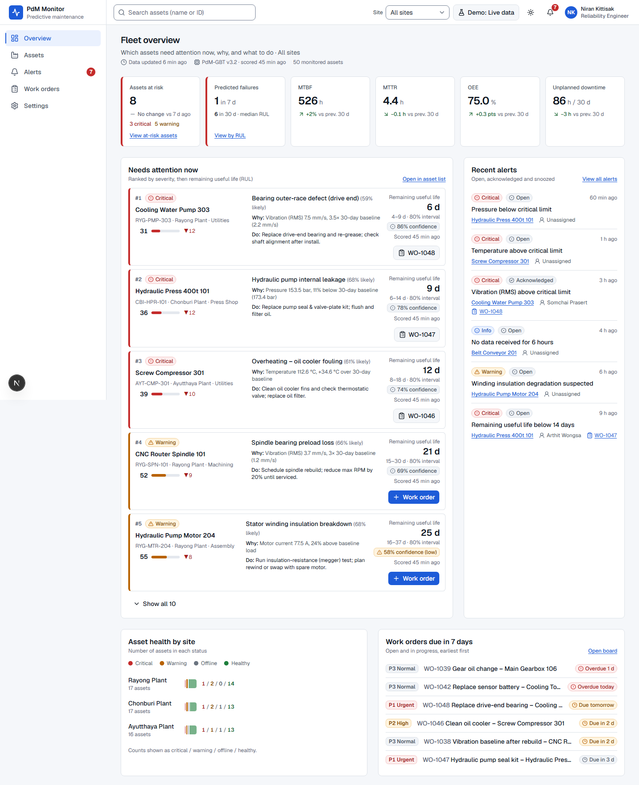

# Predictive Maintenance (PdM) Monitor

A web app for maintenance engineers, reliability engineers and plant managers that answers one question in under five seconds: **which assets need attention now, why, and what should I do?**

| Folder | What's inside |
|---|---|
| [`pdm-app/`](pdm-app) | Next.js 16 + TypeScript + Tailwind CSS v4 + shadcn/ui + Recharts app (6 screens, mock data for 50 assets). See [`pdm-app/README.md`](pdm-app/README.md). |
| [`screenshots/`](screenshots) | Every screen at 1440 and 1024 px, light and dark, plus loading / empty / error states |
| [`tools/`](tools) | QA scripts that drive headless Chrome: axe-core audit, keyboard / reflow / reduced-motion checks, screenshots |
| [`NOTES.md`](NOTES.md) | Delivery notes in Thai: assumptions, differences from the brief, WCAG 2.2 AA report |

```bash
cd pdm-app
npm install
npm run dev   # http://localhost:3000
```


